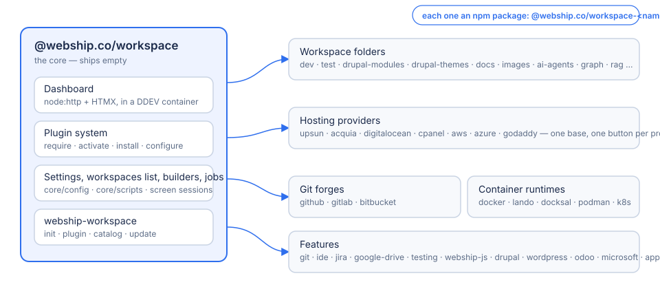

# Webship Workspace

A container-based development workspace with a web dashboard, for Webship projects: Drupal, Drupal CMS, the Webship products, and whatever else your folders hold. The core ships **empty**. Everything else is a plugin you add when you need it.



## Install

```bash
# 1. Node.js 20 or newer, Docker, and DDEV (https://ddev.readthedocs.io)
# 2. The workspace, from npm
npm install -g @webship.co/workspace
webship-workspace init ~/workspace       # the core, an empty settings file, the dashboard started
```

Open https://workspace.ddev.site. It is empty: no workspace folders, no plugins. Add what you need, one package at a time, from **Settings → Plugins** (the catalogue) or the command line:

```bash
webship-workspace plugin require dev     # npm install @webship.co/workspace-dev into the dashboard
webship-workspace plugin activate dev    # on the workspaces list
webship-workspace plugin install dev     # the folder, its settings file, its commands
webship-workspace catalog                # everything you can add
```

Nothing is added to `package.json` until you ask for it. The skeleton and the management stay in the core.

## What a plugin is

An npm package `@webship.co/workspace-<name>` (repository `github.com/webship/workspace-<name>`, branch `1.0.x`), written in TypeScript against `@webship.co/workspace-plugin-api`. Families share a base: hosting providers (`upsun`, `acquia`, `digitalocean`, `cpanel`, `aws`, `azure`, `godaddy`), git forges (`github`, `gitlab`, `bitbucket`), container runtimes (`docker`, `lando`, `docksal`, `podman`, `kubernetes`), and every workspace folder (`dev`, `test`, `drupal-modules`, `drupal-themes`, `docs`, `images`, `ai-agents`, …) is a plugin too.

## Read more

**New here?** The dashboard's own guide is in [core/workspace-app/docs](core/workspace-app/docs): the [user guide](core/workspace-app/docs/USER-GUIDE.md) for the pages and what each button does (also served at `/help`), and the [developer guide](core/workspace-app/docs/DEVELOPER-GUIDE.md) for how the app is built.

- [Getting started](core/docs/getting-started.md) — the first hour: install, add a workspace folder, build a site.
- [Plugins](core/docs/plugins.md) — the four steps, the families, writing one.
- [Workspaces](core/docs/workspaces.md) — folders, types, builders and the `cmd-*.sh` commands.
- [Testing](core/docs/testing.md) — unit tests and the webship-js browser suite.
- [Releases](core/docs/releases.md) — versions, npm, and how changes land (issues and pull requests).
- [The plugin contract](core/workspace-app/PLUGINS.md) — the manifest and the api, for plugin authors.

## License

GPL-2.0-or-later. Made by [Webship](https://webship.co).
