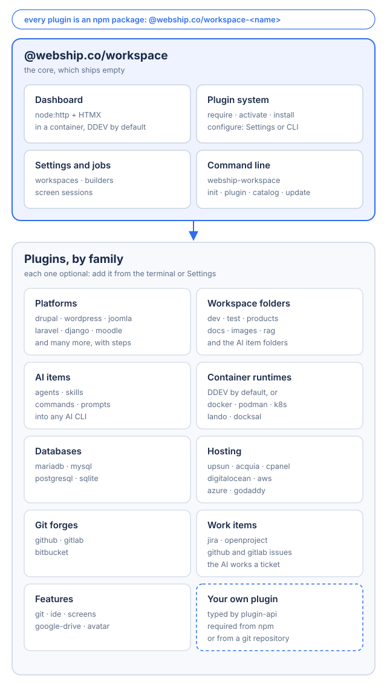

# Webship Workspace

A container-based development workspace with a web dashboard, for Webship projects: Drupal, Drupal CMS, the Webship products, and whatever else your folders hold. Each project brings its own language and version in its own containers: PHP, Python, Node.js, Java, .NET, Ruby, Go and more. The core ships **empty**. Everything else is a plugin you add when you need it.



## Install

```bash
# 1. Node.js 24 or 26 for the Workspace itself (the stable LTS releases; 26 is the one to install; your projects use
#    their own languages), Docker, and DDEV (https://ddev.readthedocs.io)
# 2. The workspace, from npm
npm install -g @webship.co/workspace
webship-workspace init ~/workspace       # the core, an empty settings file, the dashboard started
```

Open https://workspace.ddev.site. DDEV is one way to run the dashboard, and the default. The others need no DDEV:

```bash
webship-workspace init ~/workspace --runtime docker       # Docker Compose: http://127.0.0.1:3000
webship-workspace init ~/workspace --runtime kubernetes   # a Helm chart on your Kubernetes context (kubectl, helm)
```

Sites are then built on that runtime by default. For a server on a cloud there is a cloud-init file, `core/docker/cloud-init.yaml`. [Runtimes](core/docs/runtimes.md#the-dashboard-itself) says what each one needs and what is not there yet.

The dashboard is empty: no workspace folders, no plugins. Add what you need, one package at a time, from **Settings → Add a plugin** (the catalogue) or the command line:

```bash
webship-workspace plugin require dev     # npm install @webship.co/workspace-dev into the dashboard
webship-workspace plugin activate dev    # on the workspaces list
webship-workspace plugin install dev     # the folder, its settings file, its commands
webship-workspace catalog                # everything you can add
```

Nothing is added to `package.json` until you ask for it. The skeleton and the management stay in the core.

## Runtimes

A site runs on a container runtime. DDEV is the default, and a builder can also build on Docker Compose, Podman, a Kubernetes cluster, Lando or Docksal:

```bash
bash dev/cmd-drupal11-recommended-project.sh mysite --install --runtime docker      # or kubernetes, podman, lando, docksal
```

| | DDEV | Docker Compose | Kubernetes | Podman | Lando | Docksal |
|---|---|---|---|---|---|---|
| Build and install a Drupal site | Yes | Yes | Yes | Yes | Yes | Yes |
| The dashboard's row, the Tests menu, backups | Yes | Yes | Yes | The same code as Docker, not yet run on a real Podman | Yes | Yes |
| A WordPress site (the WordPress plugin's builder, tool and tests) | Yes | Yes | Yes | The same code as Docker, not yet run on a real Podman | Yes | Yes |
| A WooCommerce shop, a Joomla site, a phpBB board, a MediaWiki wiki (their plugins) | Yes | Yes | Yes | The same code as Docker, not yet run on a real Podman | On the way | On the way |
| A Laravel app (the Laravel plugin) | Yes | Yes | Yes | The same code as Docker, not yet run on a real Podman | Yes | Yes |
| The other platform plugins' builders | Yes | On the way | On the way | On the way | On the way | On the way |
| The dashboard itself | Yes | Yes | Yes, with limits | On the way | No (it builds Lando sites from DDEV, Docker Compose or Kubernetes) | No (the same, for Docksal sites) |

[Runtimes](core/docs/runtimes.md) has the whole table, what a project carries on each runtime, and how to choose a cluster.

## What a plugin is

An npm package `@webship.co/workspace-<name>` (repository `github.com/webship/workspace-<name>`, branch `1.0.x`), written in TypeScript against `@webship.co/workspace-plugin-api`. Families share a base: hosting providers (`upsun`, `acquia`, `digitalocean`, `cpanel`, `aws`, `azure`, `godaddy`), git forges (`github`, `gitlab`, `bitbucket`), container runtimes (`docker`, `lando`, `docksal`, `podman`, `kubernetes`), and every workspace folder (`dev`, `test`, `drupal-modules`, `drupal-themes`, `docs`, `images`, `ai-agents`, …) is a plugin too.

## Read more

**New here?** The dashboard's own guide is in [core/workspace-app/docs](core/workspace-app/docs): the [user guide](core/workspace-app/docs/USER-GUIDE.md) for the pages and what each button does (also served at `/help`), and the [developer guide](core/workspace-app/docs/DEVELOPER-GUIDE.md) for how the app is built.

- [Getting started](core/docs/getting-started.md) — the first hour: install, add a workspace folder, build a site.
- [Using plugins: a help guide](core/docs/plugins-guide.md) — find a plugin, add it, set it up, use it, keep it up to date, take it out.
- [Plugins](core/docs/plugins.md) — the four steps, the families, writing one.
- [Workspaces](core/docs/workspaces.md) — folders, types, builders and the `cmd-*.sh` commands.
- [Runtimes](core/docs/runtimes.md) — DDEV, Docker Compose, Podman, Kubernetes, Lando and Docksal: what works on each today, and how to build on one.
- [Platform plugins on the runtimes](core/docs/plugins-on-runtimes.md) — what a platform plugin changes to build on Docker Compose and Kubernetes, and the checklist to prove it.
- [Testing](core/docs/testing.md) — unit tests, the webship-js browser suite, and the webship-js step packs a project can add (`cmd-tools-testing.sh <project> --list-steps`).
- [Releases](core/docs/releases.md) — versions, npm, and how changes land (issues and pull requests).
- [The plugin contract](core/workspace-app/PLUGINS.md) — the manifest and the api, for plugin authors.

## License

GPL-2.0-or-later. Made by [Webship](https://webship.co).
