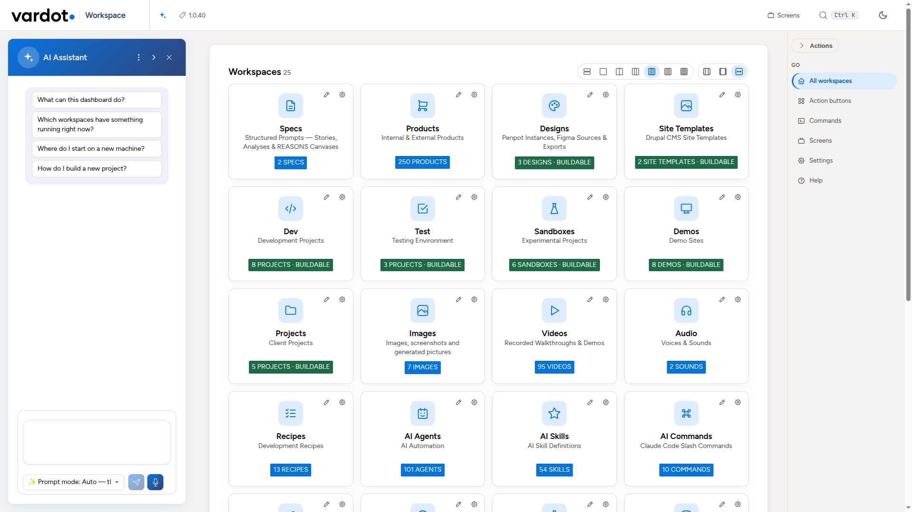
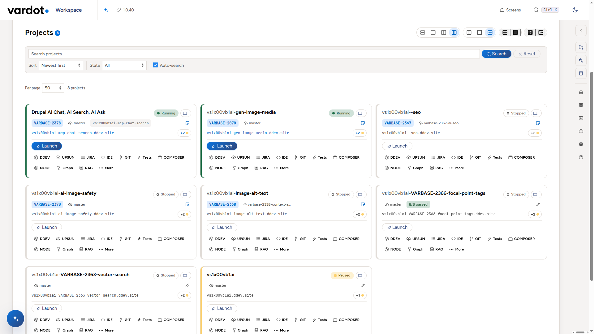
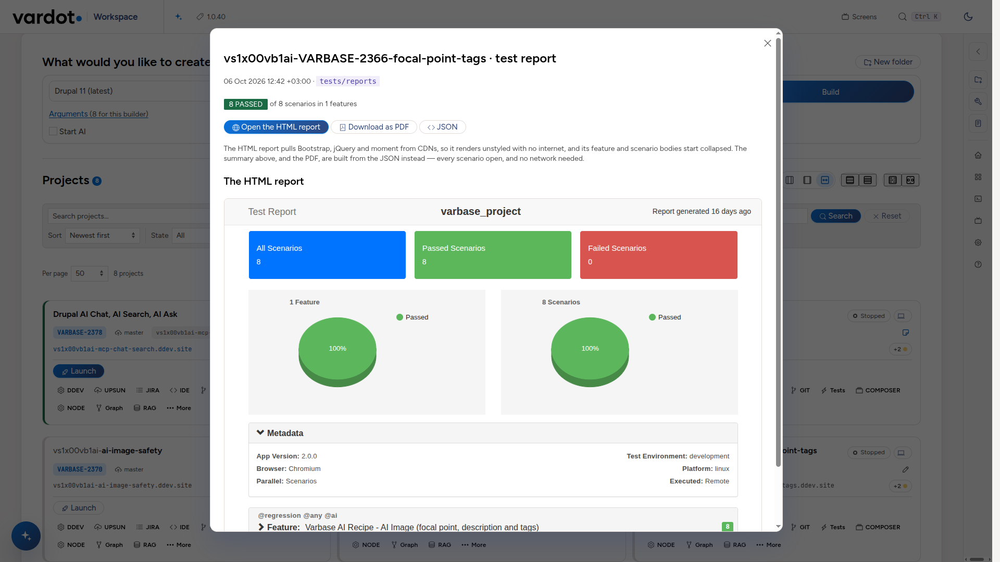
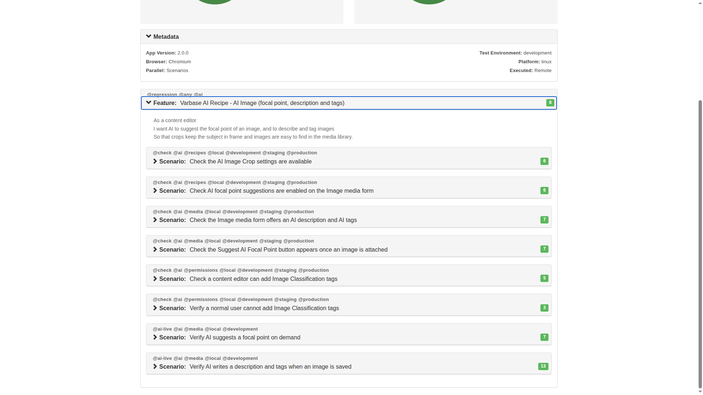
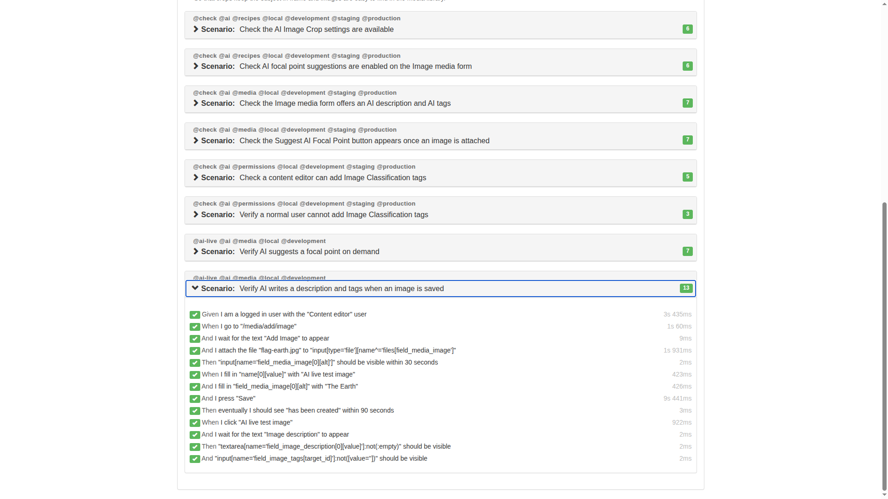
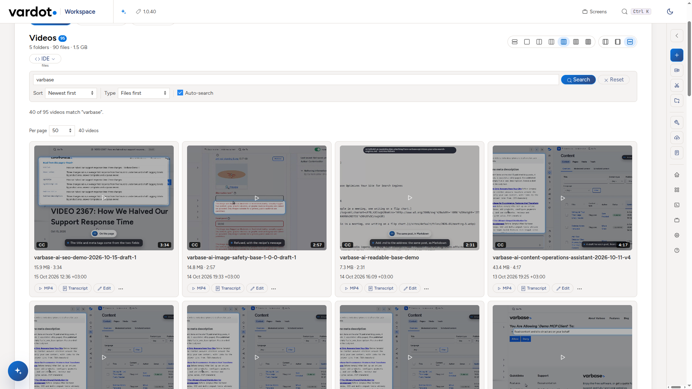
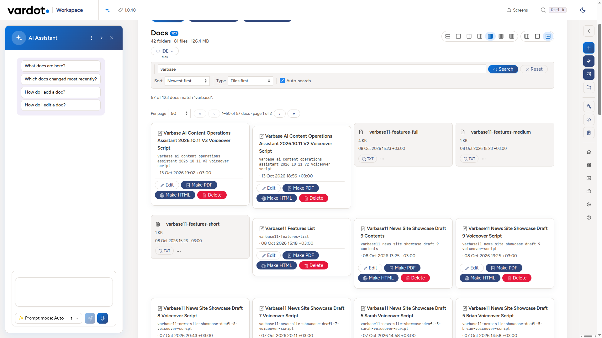

<div align="center">

<h1><picture><source media="(prefers-color-scheme: dark)" srcset="core/workspace-app/public/vardot-logo-on-dark.svg"></picture> Workspace</h1>

**Build, test, record and document Varbase, Drupal, Drupal CMS and site-template projects from one dashboard.**<br>
A set of `cmd-*.sh` commands and a web dashboard, on top of [DDEV](https://ddev.com). No host-level Apache, PHP or MySQL.

[User guide](core/workspace-app/docs/USER-GUIDE.md) &nbsp;·&nbsp; [Developer guide](core/workspace-app/docs/DEVELOPER-GUIDE.md) &nbsp;·&nbsp; [Reference](core/workspace-app/docs/REFERENCE.md) &nbsp;·&nbsp; [Releases](https://github.com/webship/workspace/releases)

   

<a href="core/workspace-app/docs/screenshots/readme/dashboard-light.png"><picture><source media="(prefers-color-scheme: dark)" srcset="core/workspace-app/docs/screenshots/readme/dashboard-dark.png"></picture></a>

</div>

> [!TIP]
> **New here?** Start with the [user guide](core/workspace-app/docs/USER-GUIDE.md): day one, and the things you will actually do. It is also the dashboard's **Help** page. All the guides are in [`core/workspace-app/docs/`](core/workspace-app/docs/).

## What it does

| | |
| :---: | :---: |
| <a href="core/workspace-app/docs/screenshots/readme/dev-light.png"><picture><source media="(prefers-color-scheme: dark)" srcset="core/workspace-app/docs/screenshots/readme/dev-dark.png"></picture></a> | <a href="core/workspace-app/docs/screenshots/readme/test-report-light.png"><picture><source media="(prefers-color-scheme: dark)" srcset="core/workspace-app/docs/screenshots/readme/test-report-dark.png"></picture></a> |
| **Dev.** Pick a builder, name the project, press **Build**. Every project row starts, stops, backs up, clones and opens it. | **Test.** Automated functional testing with Playwright and Cucumber, and the full report of each run, one click from the project. |
| <a href="core/workspace-app/docs/screenshots/readme/test-scenarios.png"></a> | <a href="core/workspace-app/docs/screenshots/readme/test-steps.png"></a> |
| **Scenarios.** Every feature and its scenarios, with their tags and counts. | **Steps.** Open a scenario to see each step, passed or failed, and how long it took. |
| <a href="core/workspace-app/docs/screenshots/readme/videos-light.png"><picture><source media="(prefers-color-scheme: dark)" srcset="core/workspace-app/docs/screenshots/readme/videos-dark.png"></picture></a> | <a href="core/workspace-app/docs/screenshots/readme/docs-light.png"><picture><source media="(prefers-color-scheme: dark)" srcset="core/workspace-app/docs/screenshots/readme/docs-dark.png"></picture></a> |
| **Videos.** Record, narrate, edit and play walkthroughs with posters and transcripts. | **Docs.** Guides, scripts and reports, searchable, with PDF and HTML made from Markdown. |

There is more: an AI assistant on every page, agents and skills for Claude Code, Upsun deploys, Jira, knowledge graphs and a RAG index. The user guide tours all of it.

## What it builds

| | Versions |
| --- | --- |
| [Varbase](https://www.drupal.org/project/varbase) | 9.1, 9.2, 10.0, 10.1, 11.0 (`x` and pinned) |
| Site templates: [Varbase Starter](https://www.drupal.org/project/varbase_starter), [Educare](https://www.drupal.org/project/educare), [Horizon Aid](https://www.drupal.org/project/horizonaid), [The Rightup](https://www.drupal.org/project/rightup) | 1.0.x, on Varbase 11 or Drupal CMS |
| [Drupal](https://www.drupal.org/project/drupal) | latest 11 and 12 |
| [Drupal CMS](https://www.drupal.org/project/cms) | latest 2 |

## Get started

Four steps. Everything after them is done from the dashboard.

**1. Get the files.** Open [github.com/webship/workspace](https://github.com/webship/workspace) (it is private: sign in), switch to the **`1.0.x`** branch, **Code → Download ZIP**, unzip it and rename the folder to **`workspace`** in your home directory, so you have `~/workspace`.

**2. Install the tools.** Docker, DDEV, git, gh, Node.js, Claude Code and the rest, plus trusted local https certificates:

```bash
bash ~/workspace/core/scripts/install.sh
```

On a fresh Ubuntu, **log out and back in** afterwards (Docker's group applies at login), then `gh auth login`.

**3. Start the dashboard.**

```bash
cd ~/workspace/core/workspace-app && ddev start
```

**4. Open it.** <https://workspace.ddev.site>, and build your first site from the **Build** form.

Updating, starting again after a reboot, and running it on a server are in the [reference](core/workspace-app/docs/REFERENCE.md#get-started).

## What is where

Every folder in `~/workspace` is a **workspace**: its own commands and its own page in the dashboard, one card each.

| | | | | |
| :---: | :---: | :---: | :---: | :---: |
|  |  |  |  |  |
| **Sites you build** | **Code we maintain** | **AI items** | **Documents and media** | **Services** |
| Build, run and test Drupal projects | Git clones of what we ship | Drafts that install into Claude Code | Guides, worklogs, recordings | Penpot, Milvus, graphify, talking avatars |
| `dev`<br>`test`<br>`sandboxes`<br>`demos`<br>`projects` | `products`<br>`modules`<br>`themes`<br>`profiles`<br>`recipes`<br>`site-templates` | `ai-agents`<br>`ai-skills`<br>`ai-commands`<br>`ai-prompts` | `docs`<br>`worklogs`<br>`specs`<br>`images`<br>`videos`<br>`audio` | `designs`<br>`rag`<br>`graphs`<br>`avatars` |

`core/` holds the build chain (`core/scripts`), the settings (`core/config`) and the dashboard (`core/workspace-app`). Built projects are never committed here.

A disk filling up? Any workspace without DDEV projects (`videos`, `docs`, `images`, …) can live on a second disk: set `storage.second` in `core/config/settings.yml`, then `bash core/scripts/storage.sh --move videos` and `--mounts`. It copies, verifies by checksum and leaves a symlink; `--back` reverses it. See [`CLAUDE.md`](CLAUDE.md#second-storage-corescriptsstoragesh-fun-storagesh).

## Learn more

- [User guide](core/workspace-app/docs/USER-GUIDE.md) and [developer guide](core/workspace-app/docs/DEVELOPER-GUIDE.md)
- [Reference](core/workspace-app/docs/REFERENCE.md): every command, flag and setting
- [`CLAUDE.md`](CLAUDE.md): how the tooling is built, and the rules it keeps
- [`docs/workspace-tips-and-rules.md`](docs/workspace-tips-and-rules.md): the short list of rules and tips
- [Releases](https://github.com/webship/workspace/releases)

Never commit credentials, API keys or real project names to this repository: keep them in your own working copy.
