# Webship Workspace documentation

Three documents, and this is the index.

| | |
| --- | --- |
| **[USER-GUIDE.md](USER-GUIDE.md)** | using the workspace: day one, the things you will actually do, and what to try when something is wrong. This is also the **Help** page in the dashboard |
| **[DEVELOPER-GUIDE.md](DEVELOPER-GUIDE.md)** | changing the tooling: adding a command, a builder, a workspace or a dashboard feature, and the rules that exist because something broke |
| **this file** | the dashboard screen by screen, with pictures — the long way round |

Beyond these three: `README.md` at the top of the repository is the full reference (every command,
every flag, how to install), `docs/workspace-tips-and-rules.md` is the distilled rules,
`core/workspace-app/README.md` is the dashboard's internals, and `worklogs/` is what changed, dated.

Every screenshot here is of a real machine. If the interface you have does not match one, the
screenshot is the thing that is out of date — say so.

---

## The home page

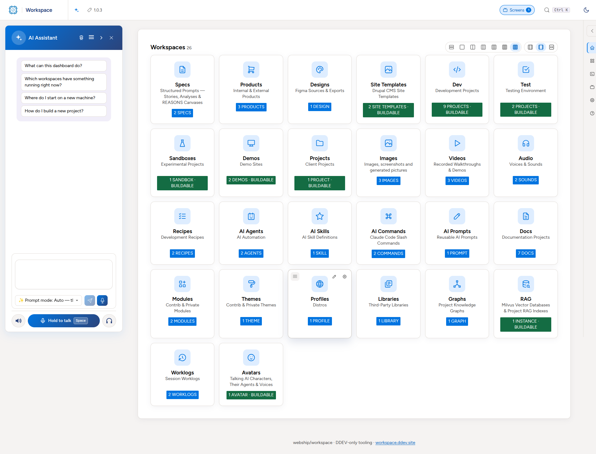

Every folder in `~/workspace` is a **workspace** with a card. The count under each is real — projects
on disk, videos, agents — and **BUILDABLE** means that folder carries builders, so a project can be
created there.

Three parts of the frame are on every page:

| | |
| --- | --- |
| **the assistant**, left | the **AI Assistant** on every page, scoped to the one you are on: on `/dev` it knows dev's projects, commands and rules. It can actually run things. Rename it, per workspace or for the whole dashboard, with `assistant: name:` |
| **the actions rail**, right | collapsed to icons by default, because a project table wants the width. It never disappears, so "what can I do here" is always in the same place |
| **the version**, in the toolbar | beside the product name. `version unknown` means the tree was installed a way that recorded none — the tooltip lists the commands that set it |

Each card carries **Edit** (its icon and description, in a window over the page) and **Settings** (its
own settings file, with the other files as tabs) in its corner:

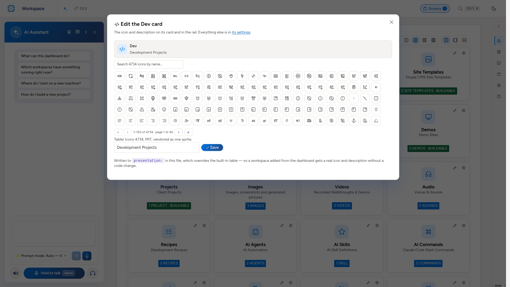

**Drag a card** to reorder: it lifts and follows the pointer, the others slide aside, the page scrolls at
its edges, and the order is saved when you let go (Escape puts it back; Alt with an arrow key moves the
focused card). The order is the `workspaces:` list in `core/config/settings.yml`, which drags the same
way in Settings. The icons come from each workspace's own settings file.

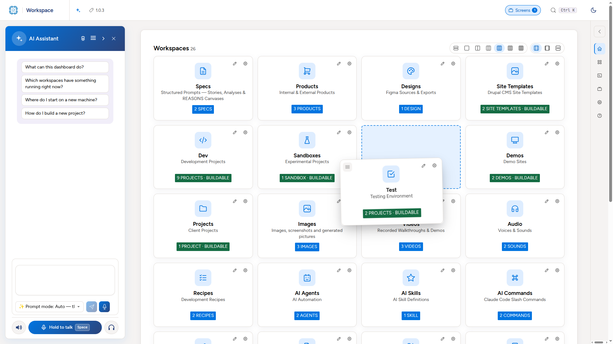

---

## A workspace page

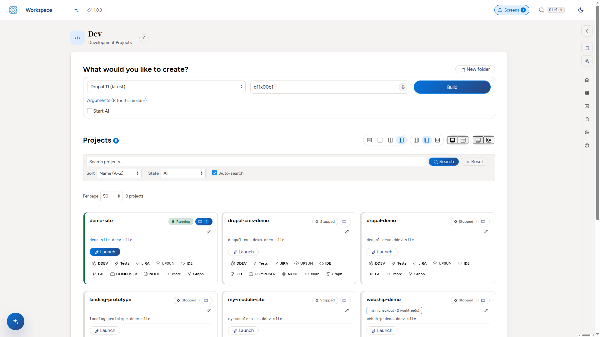

**What would you like to create?** at the top (a builder and a name, or **New folder**), then the
projects. **Build** runs in the background in a screen session — close the tab if you like, it keeps
going. **Start AI** under it starts Claude Code in the new project once the build succeeds.

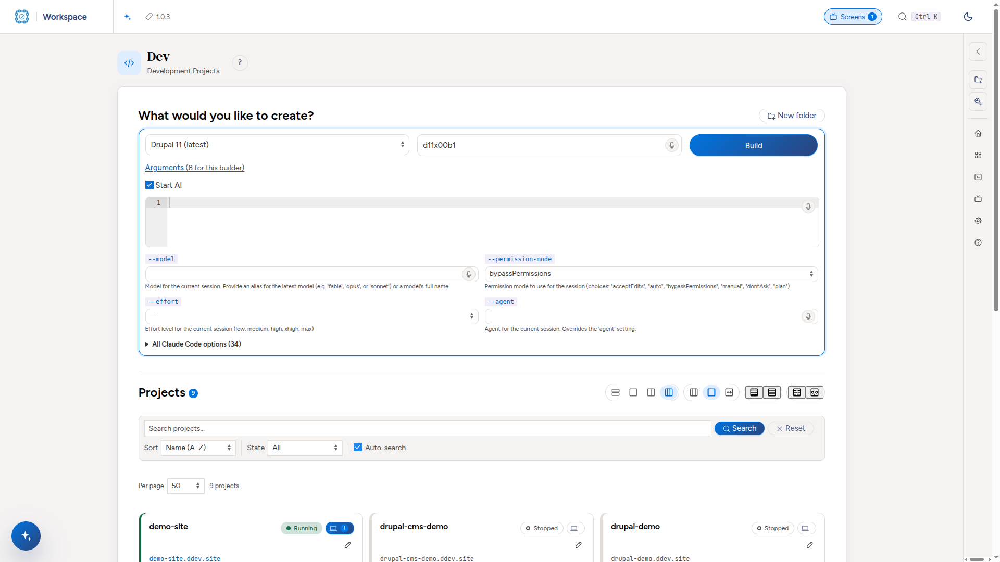

The state on each card (Running, Stopped, Paused) is also the switch: click it to start or stop the
project.

Each row carries the project's state and its addresses. A project has two that always work:

- `https://<project>.ddev.site` — the canonical one DDEV gives it
- `https://<project>.<workspace>.workspace.ddev.site` — the hierarchical one the dashboard hands out

and can be given more (see [Domains](#domains-what-a-project-answers-at)).

The captions under the buttons are status, not decoration: `22 commands`, `not linked`, `no test
report yet`, `offline`, `none`. They are what tells you whether pressing the button will do anything.

---

## The DDEV menu

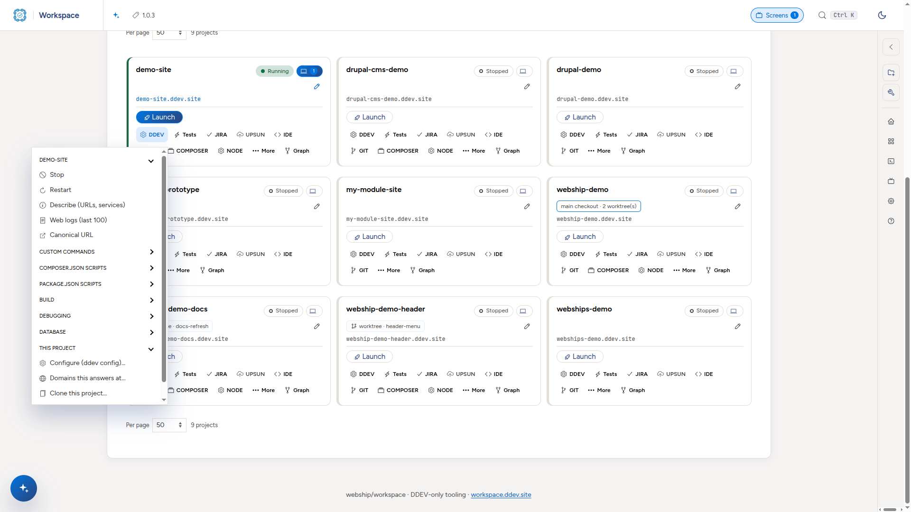

Everything DDEV can do to one project, grouped: start and stop, the build (composer), drush, the
database, and the project itself. Each entry runs the real command in a screen session and streams the
output — there is nothing here you could not type, which is the point: the button and the command line
cannot drift.

What the project defines itself is there too, each in its own folding group: its **custom commands**
(`.ddev/commands/`), its **composer.json scripts** and its **package.json scripts**.

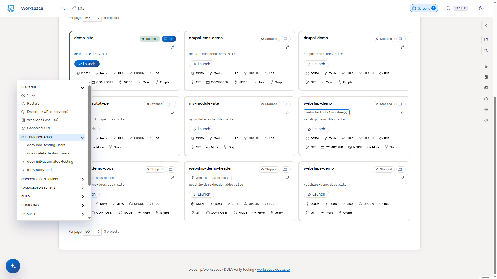

**Destructive entries ask before they fire.** Drop the database opens the confirm dialog. Remove names
what goes, offers a database backup first, and keeps its button off until the project's name is typed.

---

## Cloning: a copy, or a branch

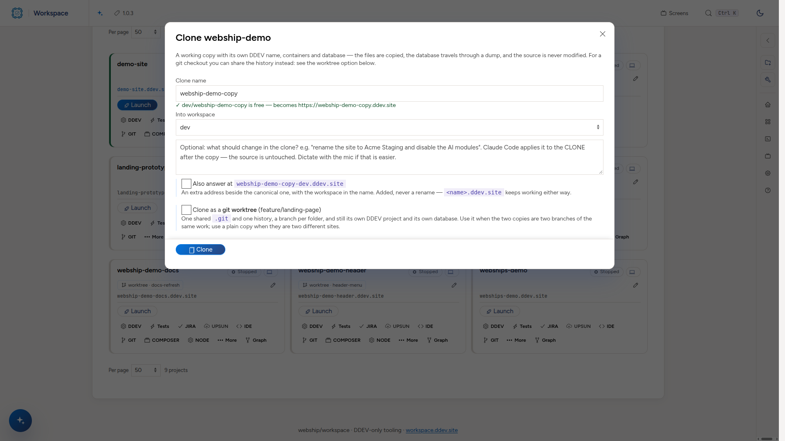

**Clone** makes a second working project from an existing one, and the form asks which of the two
things you mean.

A **copy** (the default) copies the files and sends the database through a dump. The two share
nothing and can diverge for ever. Right when they are two different sites.

A **git worktree** is offered only when the project is a git checkout, labelled with the branch that
checkout is on:

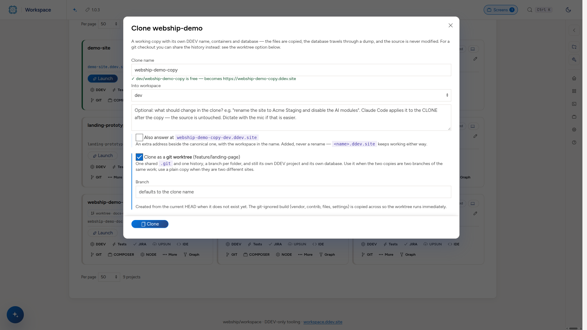

One shared `.git` and one history, a branch per folder — and still its own DDEV project with its own
containers and its own database. Right when they are two *branches of one piece of work*: somebody's
merge request running beside your own build, without a second copy of a repository whose history is
often larger than the checkout.

The branch field appears only once the option is ticked. It defaults to the clone name, and the branch
is created from the current HEAD if it does not exist yet.

Three things it does for you, each of which is a mistake people make by hand:

1. **The folder names the project.** The `name:` key is removed from the worktree's
   `.ddev/config.yaml`, so the directory decides — leave it and the worktree collides with its source.
2. **The database is never shared.** Two DDEV projects on one database corrupts on the first
   `drush updatedb`.
3. **The build is copied.** `vendor/`, contrib, the files directory and `settings.local.php` are
   git-ignored, so a bare worktree is a source tree and not a running site.

Rows say which is which, so a listing shows what belongs to what:

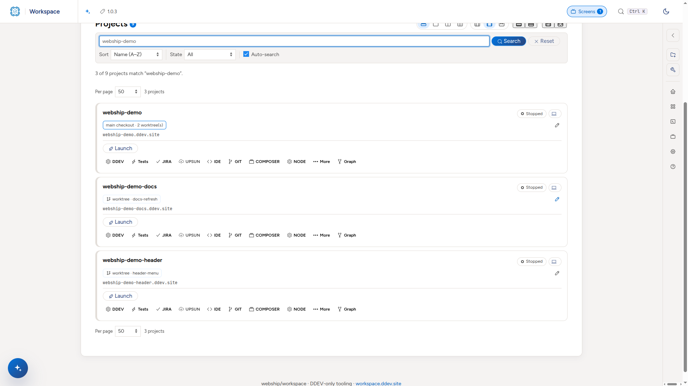

The **IDE** caption says whether there is a repository at all — `code`, `code · git`,
`code · worktree` — and the branch is inside the menu, with anything unpushed:

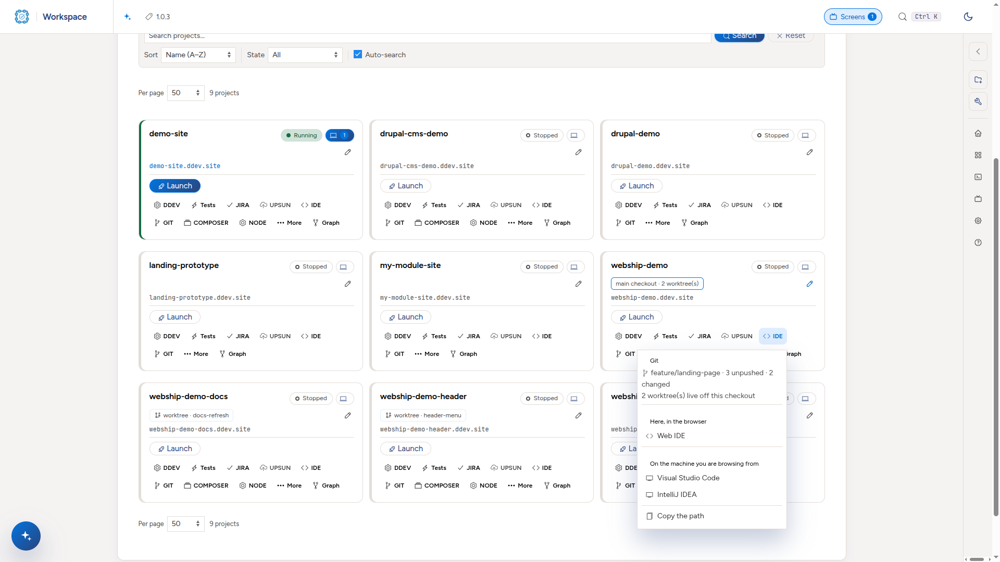

### Removing one is guarded

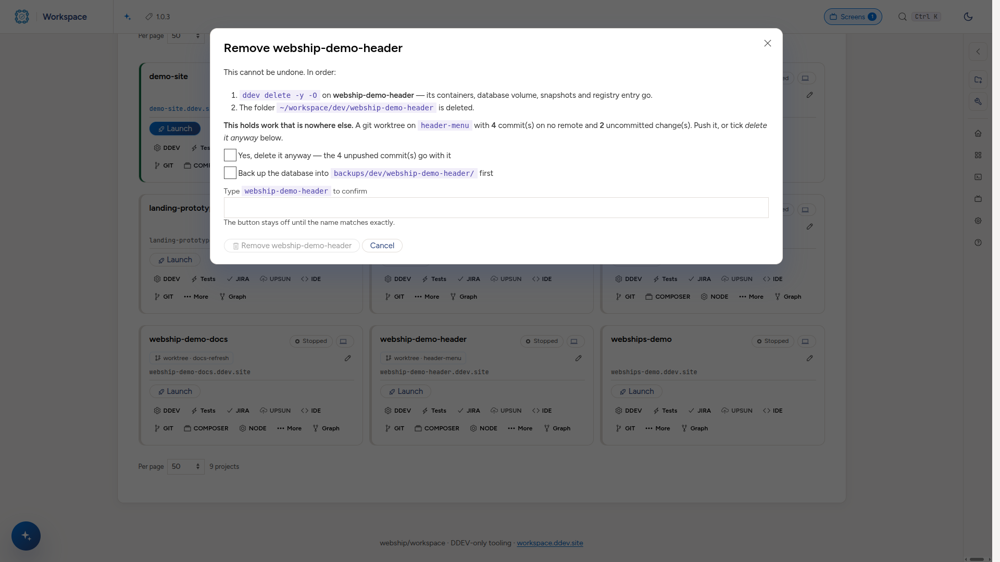

Two removals are refused before anything is deleted, because neither is recoverable and `rm -rf`
warns about neither:

- **the main checkout, while worktrees still live off it** — they would be left files with no
  repository at all;
- **anything holding commits that are on no remote**, or uncommitted changes.

Tick the extra box (or pass `--force`) to go ahead anyway. Removing a worktree normally also prunes
its registration in the main checkout, so a later clone to the same folder is not refused by git.

---

## Domains: what a project answers at

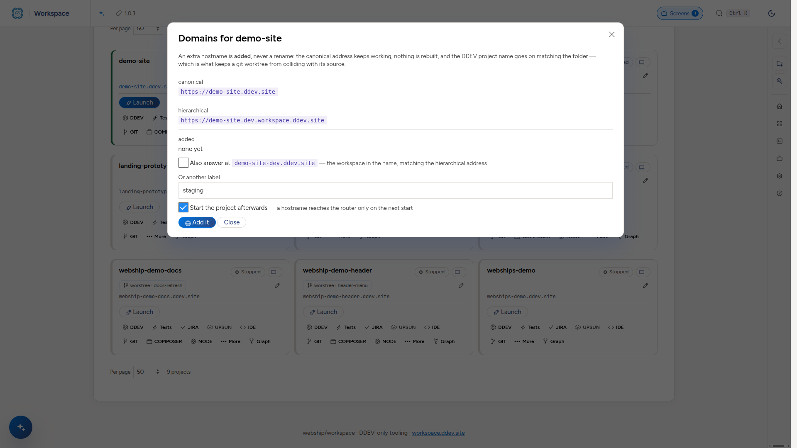

**DDEV → Domains this answers at…** lists the canonical address, the hierarchical one, and any extra
ones, and offers `<project>-<workspace>` — the workspace in one flat hostname.

It **adds**; it never renames. The canonical URL keeps working, nothing is rebuilt, and the DDEV
project name goes on matching the folder. A new address reaches the router only when the project next
starts, so the dialog offers to do that and says why.

Two projects cannot share a hostname — the router gives it to whichever started last and the other
quietly stops answering — so that is refused, naming the project that already has it.

The clone form offers the same for the copy it is about to make, and the label follows the name as you
type it:

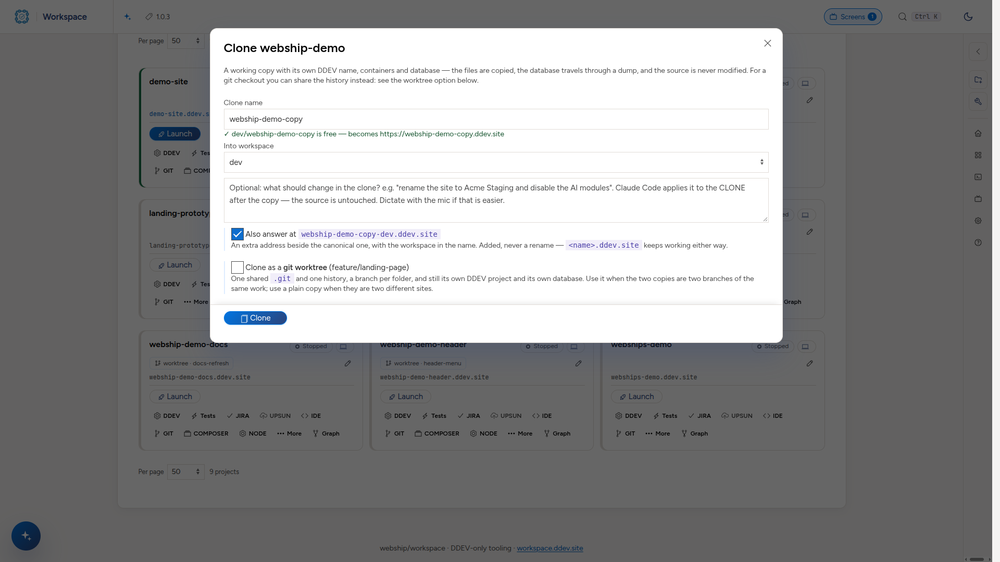

---

## Screens: anything that takes time

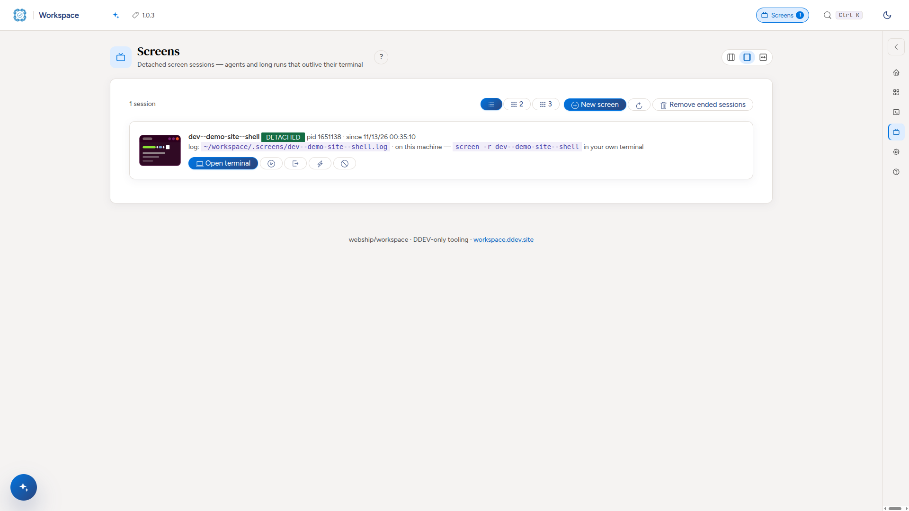

Builds, installs, test suites and AI agents run in **screen sessions**, so they survive you closing
the tab, logging out, or the dashboard restarting. This page lists them all and opens a real terminal
on any of them — you can type into it.

The useful part is the state. A session that has **stopped to ask you something** is flagged
`✋ waiting on a choice` instead of looking busy for ever, which is the difference between a job that
is running and a job that has been waiting for you for an hour.

Every card has a **SCREENS** menu too: the sessions running in that project, **New screen here…**,
**Claude Code here…**, and **Exit Claude Code** or **Resume Claude Code**.

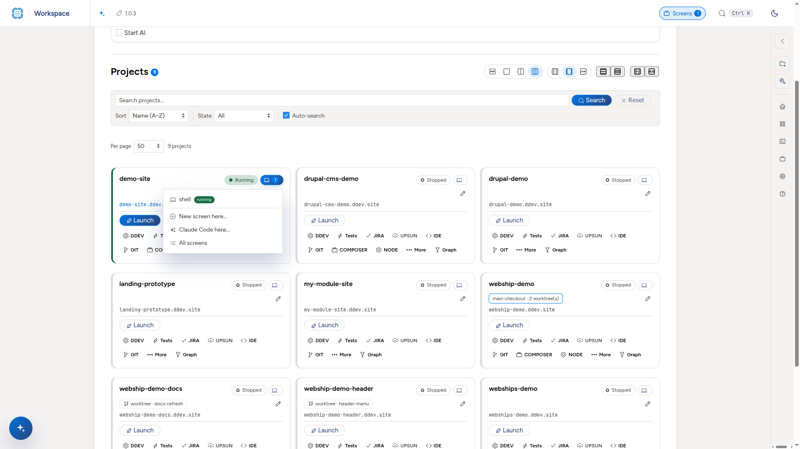

---

## Settings

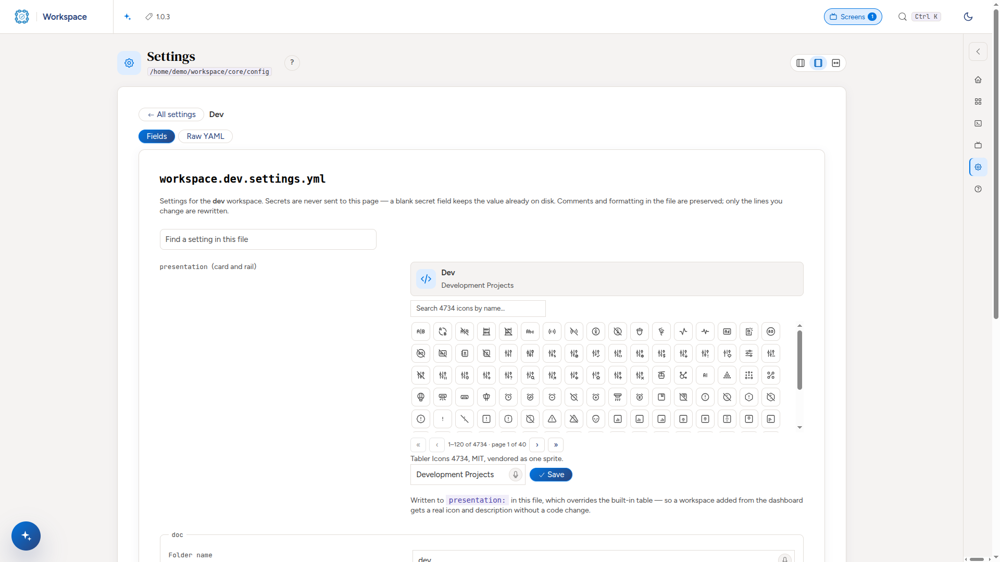

`core/config/settings.yml` and every `workspace.<name>.settings.yml`, edited from the browser. Two
things about it are deliberate and worth knowing:

- **A secret's value never leaves the server.** Anything whose key looks like a password, token or API
  key renders as an empty field marked *set — leave blank to keep it*. The value is not in the page,
  not in the response after saving, and not in `actions.log`.
- **The file is rewritten line by line**, not parsed and re-dumped, so your comments and formatting
  survive and a one-key change is a one-line diff.

Every YAML list is edited as rows with an Add field, nested ones included
(`auth.google.allowed_domains`, `auth.google.allowed_emails`):

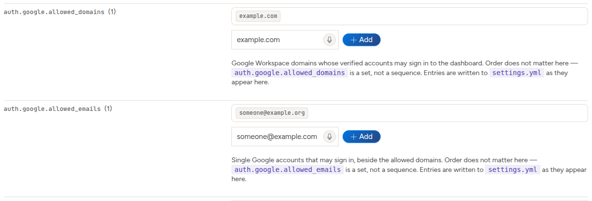

The `workspaces:` list drags like the home page cards — that order is the card order. Adding one here
creates the settings file, the folder and the DDEV hostname together. A workspace nothing uses can be
deleted from its row, after three asks: the confirm dialog, its name typed, and `YES` typed.

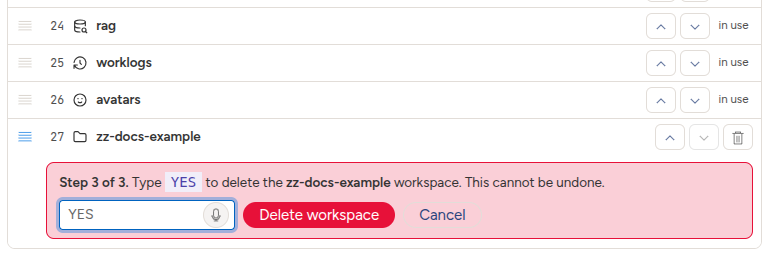

---

## Keeping it up to date

```bash
bash core/workspace-app/scripts/update.sh --check   # what you have vs the latest release
bash core/workspace-app/scripts/update.sh           # update the dashboard
bash core/scripts/sync-tooling.sh --pull            # the cmd-*.sh commands and the shared core
```

The version you are on is in the toolbar. The updater touches **only** `core/workspace-app`, and it
refuses the tooling job rather than half-doing it — so a release that adds or changes a `cmd-*.sh`
needs `sync-tooling.sh --pull` as well, and the release notes say when.

Some releases change the container image; the notes say so, and then
`cd core/workspace-app && ddev restart` is needed too.

> **If you are on 1.0.9 exactly**, run `bash core/scripts/docker-gid.sh` once. That release's updater
> mirrored the release's `.ddev/` over yours without putting this machine's docker GID back, and the
> symptom is delayed: nothing is wrong until the next `ddev restart`, when the dashboard shows **every
> project as Stopped** while they all run perfectly well. The next release re-applies it for you.

---

## Where the rest is

| | |
| --- | --- |
| changing the tooling | [DEVELOPER-GUIDE.md](DEVELOPER-GUIDE.md) |
| installing, updating, the command chain | `README.md` at the top of this repository |
| using it | [USER-GUIDE.md](USER-GUIDE.md) |
| the dashboard's internals, DDEV wiring, the security note | `core/workspace-app/README.md` |
| the hard rules and the operational traps | `docs/workspace-tips-and-rules.md` |
| what changed, dated | `worklogs/` |

The pictures in `screenshots/` are used by these guides; `assistant/` and `readme/` hold spare ones of
the assistant's avatar and of the pages in light and dark. All of them were taken on 13 November 2026
on a Webship Workspace with demo content, at 1920×1080 (the home page is taller, to show every card),
in light mode unless the name says dark. A pull request carries its own pictures on its branch.
