# Webship Workspace — the guide

This is the guide for **using** the workspace. The `README.md` beside it explains how the tooling is
built; you do not need that to do your job here.

Everything below has been done on a real machine. Where something needs a person — a password, a
browser login, a decision — it says so rather than pretending it is automatic.

---

## What this is, in two sentences

One machine that builds and runs Drupal sites — Webship, Drupal, Drupal CMS, and Webship's site
templates — each in its own DDEV container, with nothing installed on your host but Docker and DDEV.
A web dashboard drives all of it, so building a site, opening it, backing it up and throwing it away
are buttons rather than remembered commands.

---

## Day one

**1. Get the files.** Download the `1.0.x` branch of `webship/workspace` as a ZIP, unzip it, and rename
the folder so you have `~/workspace`.

**2. Install.**

```bash
bash ~/workspace/core/scripts/install.sh
```

That is the only installer. It is safe to run again at any time, and `--check` reports without
changing anything. Read what it prints at the end — every step it could not finish for you is listed
there with the command that finishes it.

**3. Log out and back in.** Not optional, and not the installer being lazy: it added you to the
`docker` group, and a group only applies at login. Until you do, everything fails with
`permission denied … docker.sock`.

**4. Start the dashboard.**

```bash
cd ~/workspace/core/workspace-app && ddev start
```

**5. Open <https://workspace.ddev.site>.**

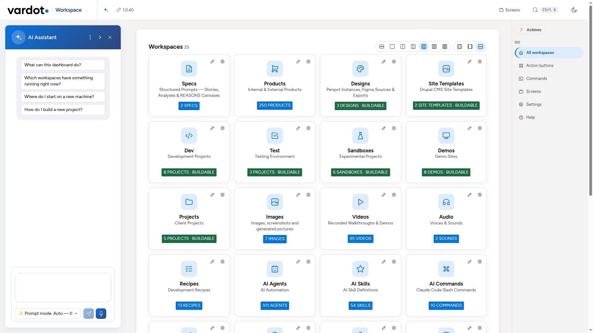

If the browser refuses the page (`ERR_CERT_AUTHORITY_INVALID`), run
`bash ~/workspace/core/scripts/trust-https.sh` and then **fully restart the browser** — a browser
reads its trust store once, at startup, so a reload will not do it.

---

## The home page

Every workspace has a card, and every card has two tools in its corner, as the project cards do:

- **Edit** (the pencil) changes the card's icon and description, in a window over the page. It writes
  `presentation:` in that workspace's own settings file, so the rail shows the same.
- **Settings** (the gear) opens that workspace's settings file, with every other settings file as a tab
  down the left.

At five or six cards across the tools show when you point at a card.

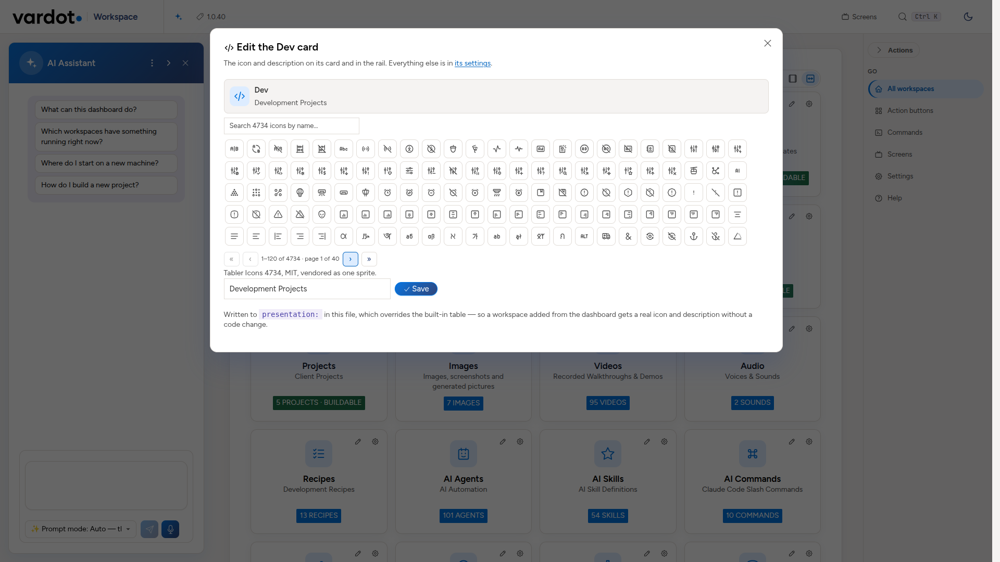

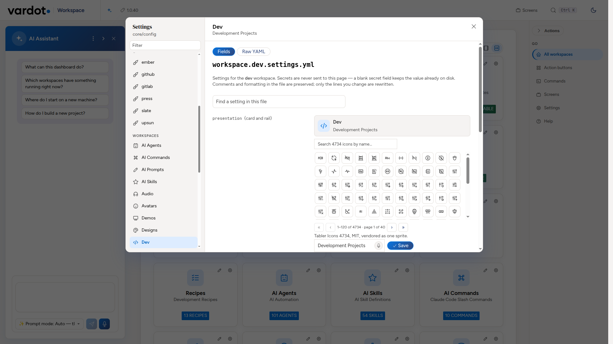

**Drag a card to change the order.** The card lifts and follows the pointer, the others slide out of its
way, and the page scrolls when you reach its top or bottom edge. Let go and the new order is saved, with
nothing redrawn; **Escape** while dragging puts it back. With the keyboard, focus a card and press **Alt**
with an arrow key. On a touch screen, drag by the handle so the page still scrolls. The order is the
`workspaces:` list in `core/config/settings.yml`, and that list in Settings drags the same way.

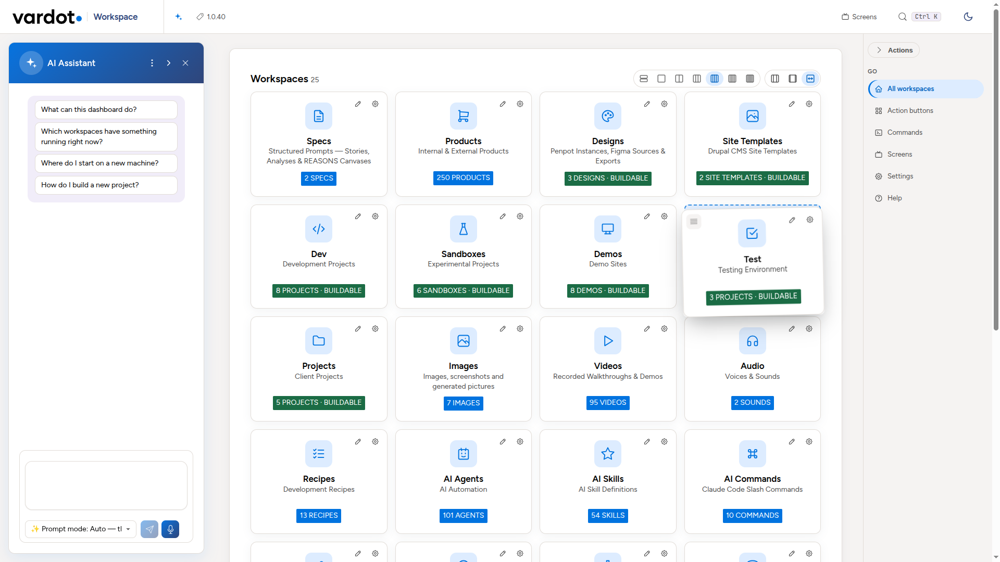

---

## The five things you will actually do

### Build a site

On any workspace page — **Dev**, **Test**, **Demos**, **Sandboxes** — the top of the page has a
build form: pick what to build, type a name, press the button. It runs in the background and you can
close the tab.

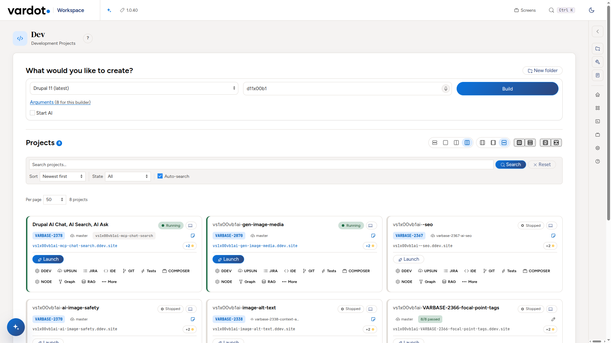

Names are lowercase letters and digits. Keep them short; you will type them again. Picking a builder
proposes a name for you, such as `d11x00b1` for the first Drupal 11 build.

The list is mostly Webship, Drupal, Drupal CMS and the site templates. At its end, in dev, test and
sandboxes, are example builders for **WordPress (latest)**, **WordPress on Composer (Bedrock)** and
**Odoo 20 Community**.

### What would you like to create?

On a workspace of projects, the card at the top is **What would you like to create?**: build a project
from a builder, or make a **New folder** with the button on its right.

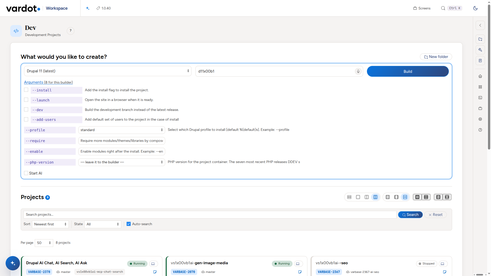

### Start AI when the build finishes

Under the build row, tick **Start AI** and say what it should do. The Claude Code options are the ones
**New screen** offers: model, permission mode, effort, an **agent** from the ones installed on this
machine, and every other option under *All Claude Code options*. Claude Code starts in the new project as
its own session, only if the build succeeds, and after the install when **Install** is ticked. Watch and
answer it on **Screens**.

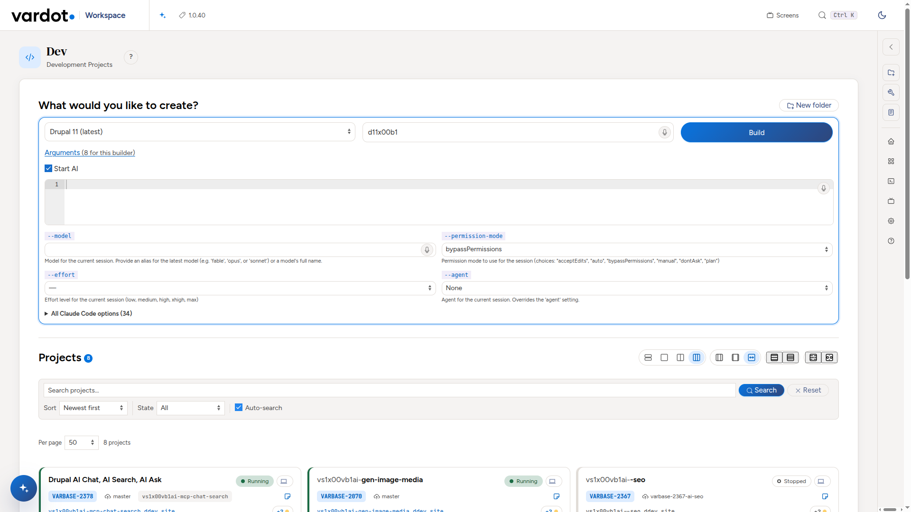

### Start from an empty folder

Not everything starts from a builder. **New folder**, in *What would you like to create?* on a
workspace page (and in the side rail), makes an empty folder that is listed with the projects. Give it
a name and, if you like, a line about what it is for; it becomes the folder's note.

You can also set it up and connect it in the same step:

- **Configure DDEV**, so the folder can start. Pick a **DDEV quickstart** (TYPO3, Laravel, Symfony,
  Craft CMS, Shopware 6, Magento 2, Joomla, Backdrop, CakePHP, CodeIgniter, Statamic, Wagtail, Node.js,
  WordPress and the rest of the DDEV docs) to fill the fields, then change any of them: project type
  (every type DDEV supports), docroot, PHP 5.6 to 8.5, database (MariaDB, MySQL or Postgres, every
  version DDEV supports), web server, Node.js version, Composer version, no database container, and
  Python. DDEV has no Python version setting; the Python option adds pip and venv to the web image.
  The row's **Configure DDEV** offers the same fields, starting from what the project uses.

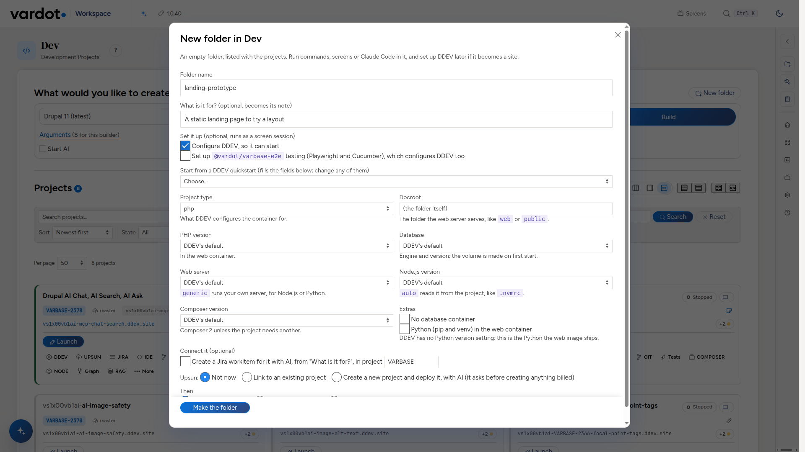
- **Set up `webship-js` testing** (Playwright and Cucumber). It configures DDEV first, then
  installs the package and the browser, and the row's **Tests** menu can run the suite.
- **Create a Jira workitem for it with AI**, written from "What is it for?", in your default Jira project.
- **Upsun**: link it to an existing project by its id, or create a new project and deploy it with AI.
  Creating one costs money, so Claude Code asks you for the organization, region and plan first.

The setup runs as one screen session, in that order. The AI tasks run in a Claude Code session in the
folder, with your own first message after them. Then choose what happens next: nothing, a terminal in
it, or Claude Code in it.

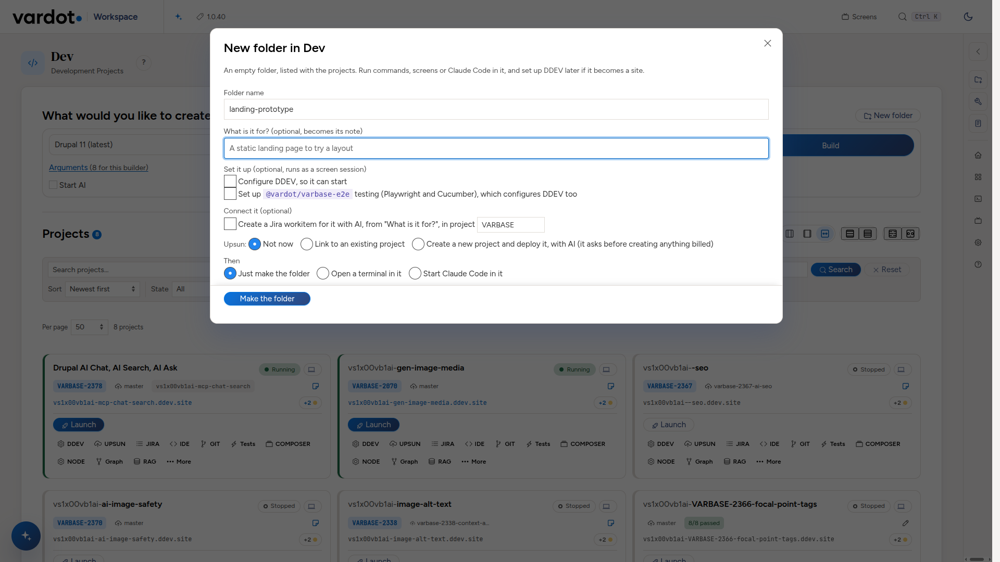

The folder's row works like any project without DDEV: **Screens**, **Claude Code here**, **IDE**,
**GIT** (`git init` included), the note, and every command that runs on a project or a folder. If it
grows into a site, **Configure DDEV** on the row sets it up.

In a files workspace (Docs, Specs, Designs, Images, Videos, Audio), **New folder** is in *What would you
like to create?* and the side rail too. It makes the folder inside the one you are looking at, takes a
readable name (capitals, spaces and dots are fine), and the optional note; there is nothing to set up.

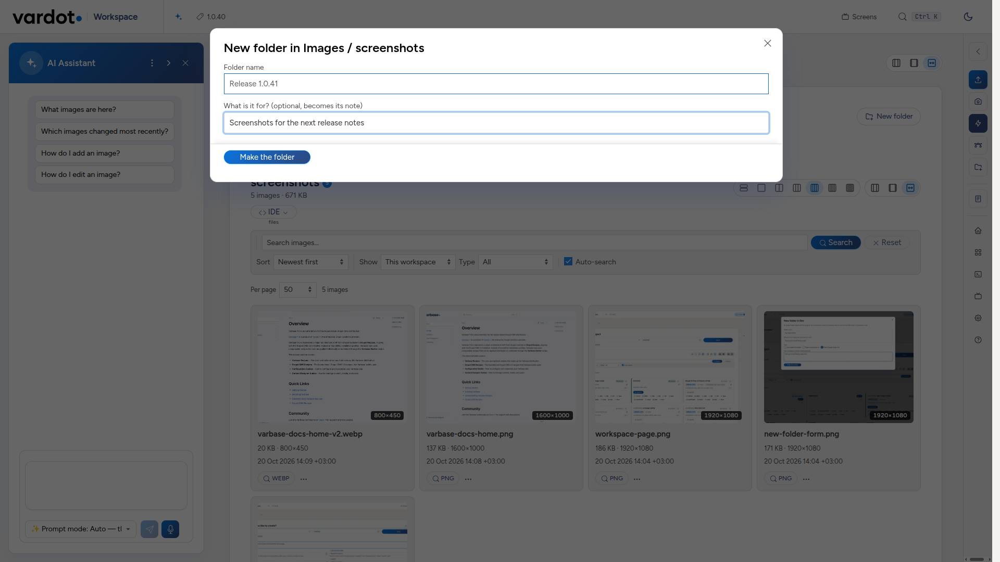

### Open it

Each project row has **Launch**. A project has two addresses and both work:

- `https://<project>.ddev.site` — the canonical one DDEV gives it
- `https://<project>.<workspace>.workspace.ddev.site` — the hierarchical one the dashboard hands out

### Start, stop, back up, remove

**The state on the card is the switch.** Click **Stopped** or **Paused** to start the project, and
**Running** to stop it (that one asks first). Pointing at it shows the word it will do: Start or Stop.

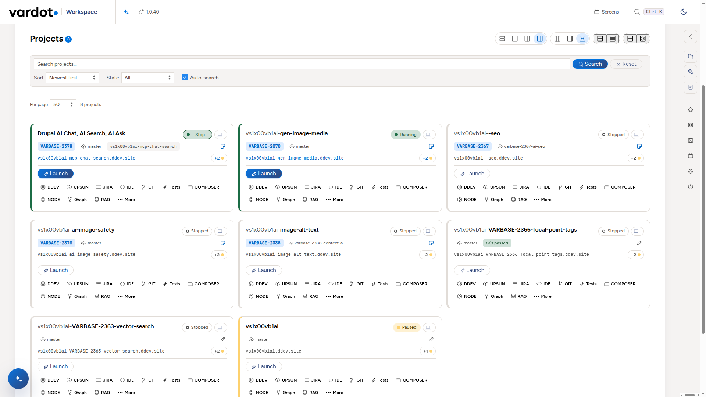

Everything else is in the **DDEV** menu on the row. Backups land in `~/workspace/backups/<workspace>/`
and appear on that workspace's **Backups** page.

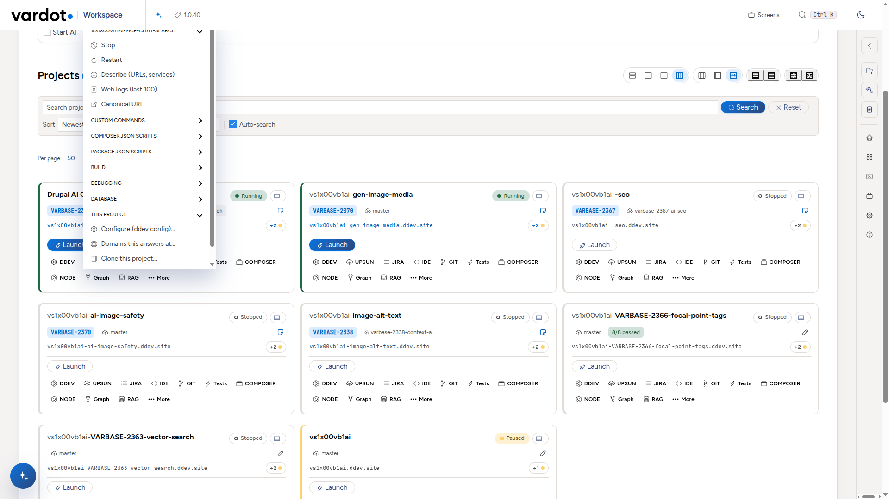

The menu also lists what the project itself defines, each in its own group that folds open:
**Custom commands** (the `ddev` commands in its `.ddev/commands/`), **composer.json scripts** and
**package.json scripts**. Each runs in a screen session, like the rest of the menu.

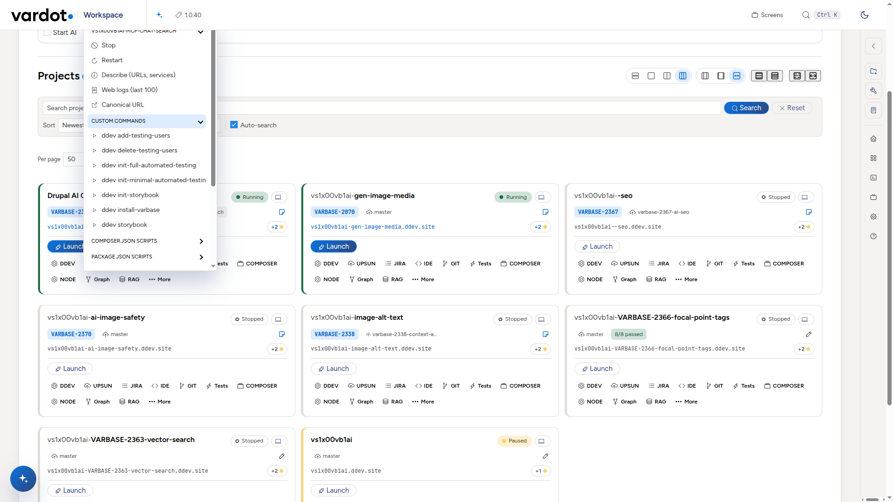

**The assistant can be shown four ways.** The ✨ switch at the left of the toolbar shows and hides it —
closed, the page has the whole width. Its header menu (⋮) offers **Sidebar** (the column it starts as),
**Wide** (the same column doubled, for a long answer), **Floating** (a button in the corner, the panel
over the page) and **Full page** (`/assistant`, the whole width). The › button beside the menu is the
same as Wide, one click. Your choice is remembered in this browser; `style: assistant_view:` in
`settings.yml` sets what everyone starts with.

**The conversation follows you.** Ask the assistant something on `/dev`, move to `/test` or let it take
you there, and the chat is still there — and so is what it remembers, because it picks its own session
back up rather than starting over. **New chat** in the panel header ends one and starts another; it asks
first, and what the assistant remembered of that conversation goes with it.

**Every important action asks first.** Delete, Remove, Drop the database, resetting the buttons to
their defaults and any command marked as asking all open the same dialog — *Wait! Are you sure you
want to proceed with this action?* — with the action and what it belongs to named under it. **No**
does nothing, and so do Escape, the ✕ and clicking outside it; only **Yes** goes through.

**Remove spells it out and asks for the name.** **DDEV → Remove the project…** lists what goes (the
DDEV project with its database, and the folder), offers to back up the database first, says when the
project holds commits that are on no remote or uncommitted changes, and keeps its button off until you
type the project's name exactly. Deleting the folder by hand is not the same thing — it leaves the
database volume, the snapshots and the built images behind, invisible until your disk is full. Use the
button, or `cmd-tools-remove.sh`.

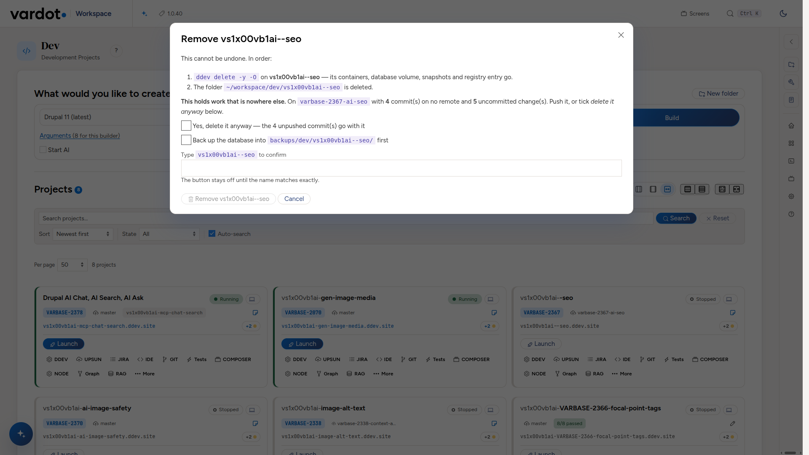

### Copy one, or branch one

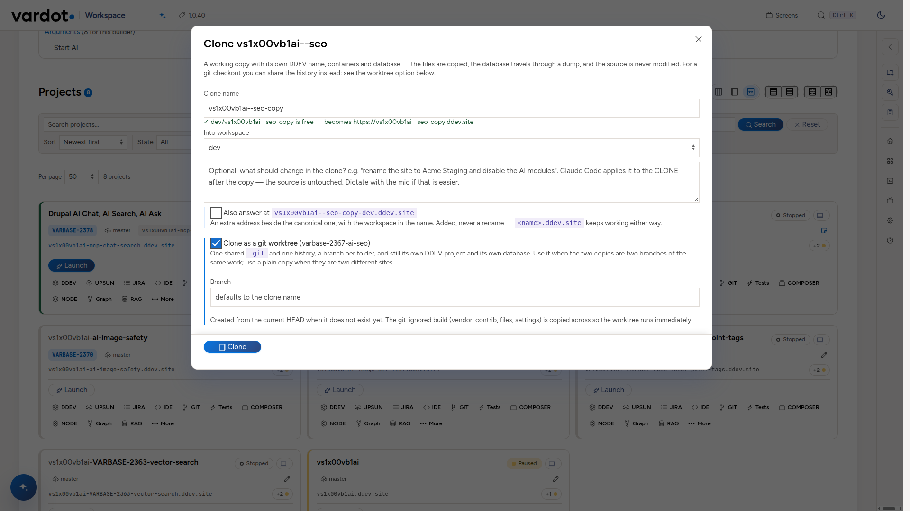

**Clone** on the row makes a second working project from an existing one. Two shapes, and the form
asks which:

- **A copy** (the default) — the files are copied and the database travels through a dump, so the two
  projects share nothing and can diverge for ever. Use it when they are two different sites.
- **A git worktree** — offered only when the project is a git checkout. One shared `.git` and one
  history, a branch per folder, and still its own DDEV project at its own URL with its own database.
  Use it when they are two branches of the same work: reviewing somebody's merge request beside your
  own build, both running at once, without a second clone of a repository whose history is often
  larger than the checkout.

The clone name becomes the DDEV project name, so `ace_editor-copy` answers at
`https://ace_editor-copy.ddev.site`. On the worktree path the **folder** is what names the project —
that is why the branch you pick and the folder you get are separate fields.

The git-ignored build (`vendor/`, contrib, the files directory, `settings.local.php`) is copied into
the worktree, because git does not carry it and a worktree without it is a source tree rather than a
running site.

**Removing them is guarded**, because two of the three ways to do it destroy work silently:

- Removing the **main checkout** while worktrees still live off it is **refused**, and the reason lists
  them. Its `.git` is the only copy of the repository those folders have; deleting it leaves each of
  them files with no branch, no history and nothing to push.
- Removing anything holding **commits that are on no remote**, or uncommitted changes, is **refused**
  and the count is shown. Push it, or say explicitly that you want it gone.
- Removing a worktree normally also **prunes its registration** in the main checkout, so a later
  clone to the same folder is not refused by git.

Both refusals are overridden the same way: tick the extra box in the Remove dialog, or pass `--force`.
Nothing is deleted before the check runs.

`git worktree remove` by hand does none of this — it will delete a worktree that holds unpushed
commits. Use the row's **Remove** button, or `cmd-tools-remove.sh`.

Each row says what it is: **worktree · `<branch>`**, or **main checkout · N worktree(s)**.

From the command line, in the workspace folder:

```bash
bash cmd-tools-clone.sh <project> --to <name>                      # a copy
bash cmd-tools-clone.sh <project> --to <name> --worktree           # a worktree, branch <name>
bash cmd-tools-clone.sh <project> --to <name> --worktree --branch 3512345-the-fix
```

### Give it another address

A project's URL comes from its DDEV **name**, so `blog2` answers at `https://blog2.ddev.site`, and the
dashboard hands out `https://blog2.dev.workspace.ddev.site` as well. **DDEV → Domains this answers at…**
shows everywhere a project answers, and adds another: any flat hostname you like, or the one it
suggests, `<project>-<workspace>.ddev.site`.

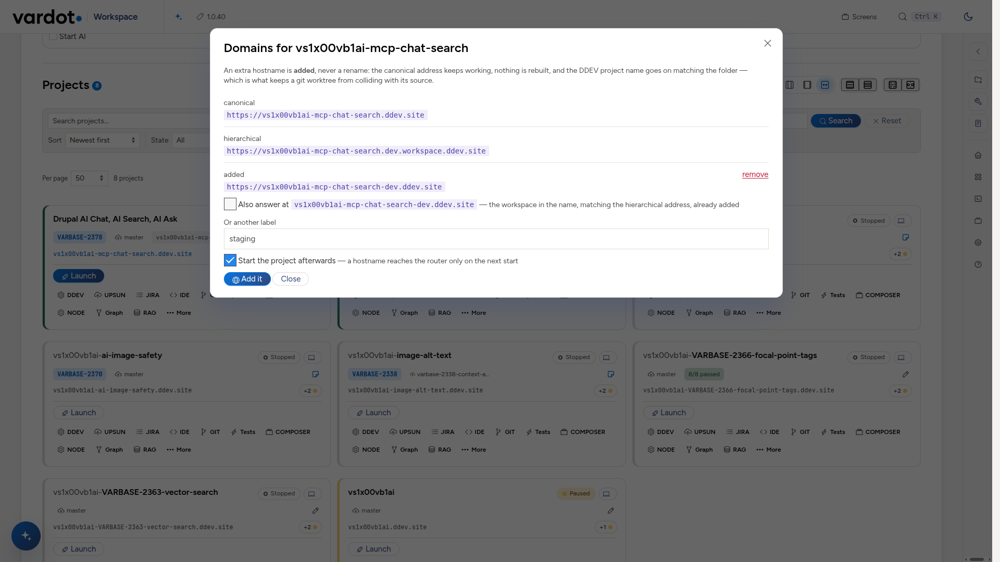

It **adds**, never renames: the canonical address keeps working, nothing is rebuilt, and every link
already written down stays valid. A new address reaches the router when the project next starts, so the
dialog offers to do that. Two projects cannot share a hostname (the router would give it to whichever
started last), so trying is refused with the name of the one that already has it. The clone form offers
the same for the copy it is about to make, and so does the command line:

```bash
bash cmd-tools-hostnames.sh                                   # every project here, and its addresses
bash cmd-tools-hostnames.sh blog2 --with-workspace --start     # blog2-dev.ddev.site
bash cmd-tools-hostnames.sh blog2 --add staging --start
bash cmd-tools-hostnames.sh blog2 --remove staging
```

### Work on the code

The **IDE** menu on the row, right after JIRA and followed by **GIT**:

- **Web IDE** — VS Code in your browser, opened on that project. Works from any device, needs
  nothing installed.
- **Visual Studio Code** / **IntelliJ IDEA** — opens the project in the editor on *your own machine*.
  Needs that editor's URL handler; if nothing happens, use **Copy the path** and open it from a
  terminal.

The Web IDE has a terminal (`Terminal → New Terminal`), and its terminal dropdown offers **Claude
Code** — the same agents and skills you have on the command line, already loaded.

The **COMPOSER** menu, right after SCREENS, is on every folder that has a `composer.json`. What it
offers depends on the workspace.

In **dev**, **test**, **demos**, **sandboxes** and **projects** (the sites) it is the full menu:

- **Daily** — first, because they are what you run every day: install, update, outdated and validate.
- **Inspect** — `update --dry-run` to see what an update would do, show (direct or as a tree),
  audit, platform requirements and licenses.
- **Maintenance** — `update --lock` and `dump-autoload -o`.
- **A package** — type `vendor/name` (with `:^1.0` for require) and pick require, update -W,
  remove, require --dev or why.
- **Scripts in composer.json** — the folder's own scripts, with their aliases. Event hooks
  (`post-update-cmd` and the like) are not listed: they run by themselves.

Everywhere else (**products**, **modules**, **themes**, **recipes**, **profiles**: package clones, not
sites) the menu never installs. It only adds to `composer.json`: **require**, **require --dev** and
**remove** run with `--no-update`, which changes that one file and nothing else. It also offers
**validate** and links to edit the file. A workspace chooses with `composer: full` or
`composer: manifest` in its own settings file, and manifest is the default.

Every command runs in a screen session, and the toast at the top opens it. A DDEV project runs
`ddev composer`; any other folder runs composer in the dashboard's own DDEV container. Clicking a
command whose run is still going leaves that run alone and links to it.

The **NODE** menu, right after COMPOSER, is on every folder that has a `package.json`, in every
workspace. It opens on a **yarn | npm** switch, and each side says whether its lock file
(`yarn.lock`, `package-lock.json`) is there. It starts on the one the project uses: its
`packageManager` pin, else its lock file. If the project pins yarn, the npm side warns that running
npm there would write a second lock file.

- **Daily**: install, install from the lock (`npm ci`, `yarn install --frozen-lockfile`, or
  `--immutable` on Yarn 2+), outdated (`yarn upgrade-interactive` on Yarn 2+) and audit.
- **Inspect**: the direct dependencies and the version.
- **Maintenance**: update, dedupe and the cache.
- **A package**: type `name`, `@scope/name` or `name@^1.0` and pick add, upgrade, remove,
  add --dev or why.
- **Scripts in package.json**: run with `npm run` or `yarn run`. Lifecycle hooks are not listed.

It runs like COMPOSER: in a screen session, as `ddev npm` / `ddev yarn` in a DDEV project, and in the
dashboard's DDEV container anywhere else (`corepack yarn` when the project pins a Yarn version).

### Run any command on anything

**Commands**, in the rail, lists every command the dashboard can run and what each one runs on: a
workspace folder, a project, a folder or a file. The built-in commands ship with the dashboard, yours are
kept in `core/config/commands.yml`, and every `cmd-*.sh` in the tree is listed as a script.

- **Run** asks where: a workspace, then a project, then a folder or a file. The path box suggests names
  as you type. The command runs in a screen session, like everything else.
- **New** adds a command: a command line, or a script with its arguments. `{{project}}`, `{{file}}` and
  the other values are filled in and quoted for you. A line cannot contain `$` or a backtick.
- **Edit** a built-in command, and your version takes its place; delete yours and the built-in one is
  back. Built-in commands cannot be deleted, but they can be copied.
- **On buttons**, on a command's page, lists the buttons it is on; **Add to a button** puts it on
  another, where it runs on the row's project. A command a button uses cannot be deleted until it is
  taken off.
- **Definition** is your commands as YAML. **Check** says what loading it would change, and saves nothing.

### Arrange the row

**Action buttons** in the rail, on any page — or **Commands → Buttons** — is rows management for every project
row. With
nothing changed, the row is exactly as it has always been.

**Rows** — the rows of buttons, top to bottom:

- **Add a row**, move one up or down, or remove it (its buttons move to the row above). The first row
  sits beside the running and test badges.
- **Buttons**: drag one to another row, or pick its row, or put it in **Hidden**.
- **Open a button** to arrange what is inside it. Drag its groups, and the commands inside a group,
  into the order you want, and tick a group or command to hide it. Each command also has ↑ ↓ arrows,
  for a phone or a keyboard where dragging is awkward. The dashboard's own commands are marked
  **built in**: they can be moved and hidden, never deleted.
- **Add an action** right inside the button: a label, its group, which folders it shows on, one
  command per line, and whether it keeps going after a failed step, asks before running, and opens
  **a toast** linking to its session or **its screen** straight away. Your actions can be edited and
  deleted in place.
- **Use a command** from Commands instead of typing it: pick it in the box, or write a step as
  `use: <command id>`. It runs on the row's project, asks for its options, and keeps its own filter of
  which folders it is for. A command picked alone becomes the whole action, with its name and group.
- **Add a button** makes a menu of your own, starting with its first action.

Nothing is kept until **Save**, which stays at the bottom of the screen while you scroll. Once you
change something the bar says **Unsaved changes**, and the browser asks before you leave the page.
Saving keeps the buttons you had open and your place on the page.

**Activity** lists the last runs of your actions, newest first, with how each ended (succeeded,
failed, or which step failed), and a link to a run still going.

**Definition** is the whole file as YAML: copy it to keep or share it, or paste one in. **Check** says
what would change and saves nothing. Loading can replace the whole file, or take only its actions and
skip or update an id that already exists. An empty paste is refused (Reset to the defaults is the way
back), and so is a definition too large or too deeply nested to be a layout. It also has an example of
an action with every field, borrowed from Rundeck's job model:

- **Steps** can have an `on_error` step that runs when that step fails.
- **Options** are asked for in a form before it runs. A value goes into a step as `{{opt.name}}`,
  checked against its allowed values or pattern, and quoted.
- **`when`** is a filter where every clause must match, for example
  `[ddev, composer, "!workspace:products"]`.

An action runs in the project's folder, on this machine, so use `ddev …` for anything inside a site. A
command cannot contain `$` or a backtick; use an option for a value. Everything is kept in
`core/config/row-actions.yml`, and **Reset to the defaults** (in Definition) puts it all back. Hiding
only takes a command out of the menu; it does not switch the command off.

### End Claude Code, and pick it up again

A screen running Claude Code offers **Exit Claude Code (/exit)**, in the card's **SCREENS** menu and on
**Screens**. It asks first, then closes any question Claude has open, types `/exit` and presses Enter, so
Claude ends the way it would if you typed it, and the conversation is kept. When no Claude Code runs in a
project or folder that has one, the same menu offers **Resume Claude Code**, which resumes the last conversation
with `claude --resume` in that folder.

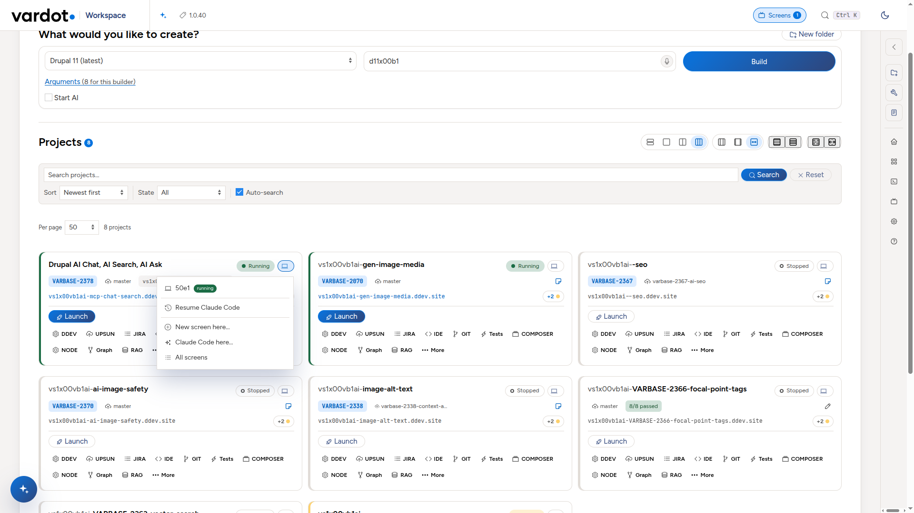

### Watch something long

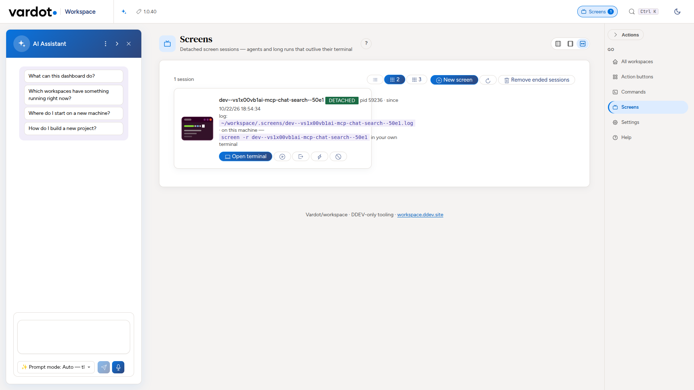

Builds, installs, test suites and AI agents run in **screen sessions** so they survive you closing
the tab. The **Screens** page lists them all, opens a real terminal on any of them, and — this is the
useful part — flags one that has **stopped to ask you something** with `✋ waiting on a choice`,
instead of leaving it looking busy for ever.

On a project card the screens sit beside the site's state: the screen icon, how many are running, and a
✋ when one waits for you. Its menu starts **New screen here…** (a shell in that project) or **Claude
Code here…** (the same form with Claude Code already chosen). Picking **Open terminal** from the Screens
list closes the list, so you can type into the terminal straight away.

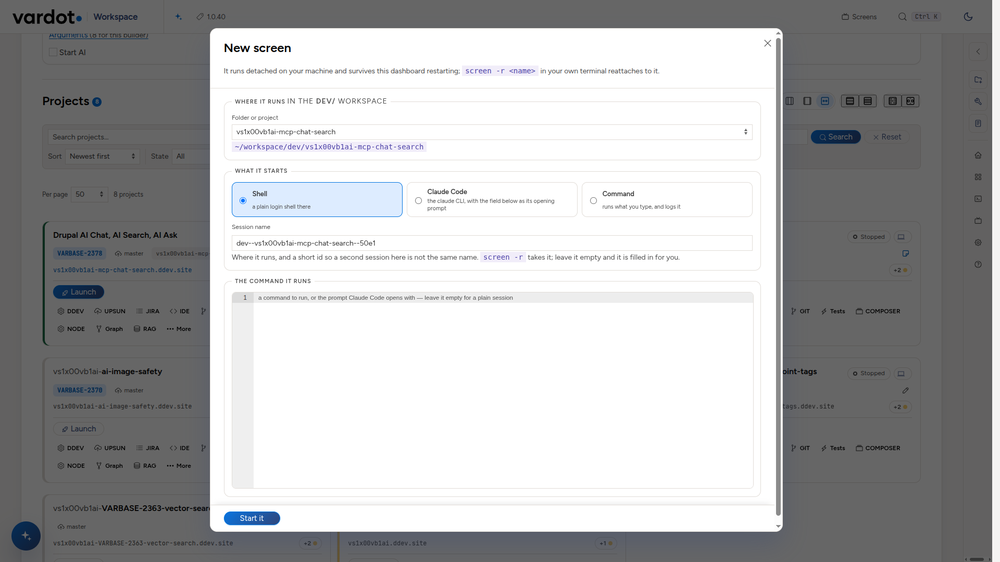

The form asks where it runs (the workspace folder or one of its projects), what it starts (a shell,
Claude Code, or a command you type), and an optional session name. `screen -r <name>` in your own
terminal attaches to the same session.

---

### Find an image

**Images** (`https://images.workspace.ddev.site`) is a gallery of every picture in `images/`: folders
first, then thumbnails with their size and date. Search by name, sort by date, name or size, and narrow
to one type. Click a picture for the viewer: the next and previous one (or the arrow keys), actual size,
and buttons to download it, copy its link or a Markdown line for a doc, rename it or delete it.

**All media images** shows, read-only, the pictures in docs, videos, audio, specs and designs, and the
dashboard's own screenshots, each labelled with where it lives.

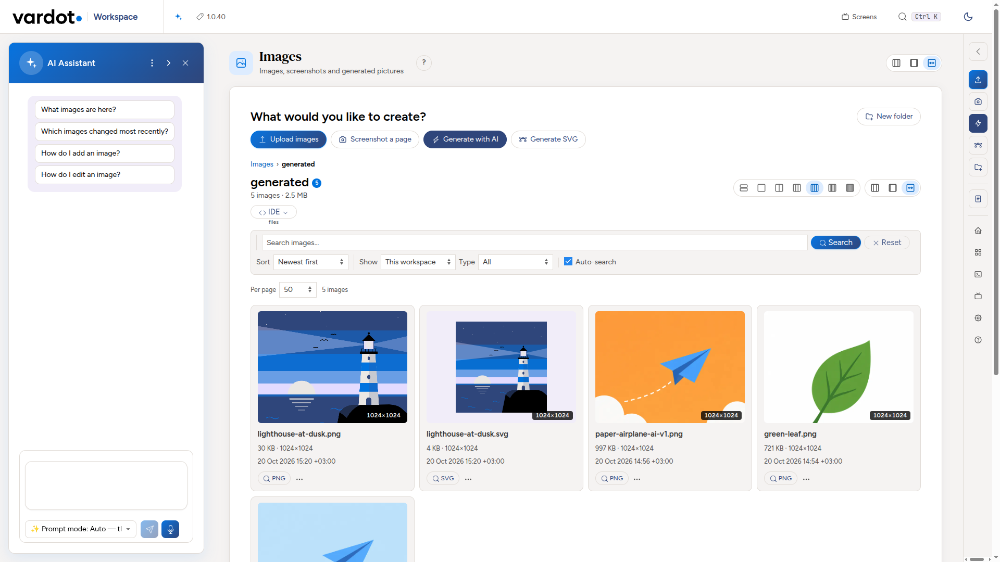

### Make an image

On the **Images** page, under *What would you like to create?*:

- **Upload images**: drop pictures on the box or choose them, and pick the folder they go in.
- **Screenshot a page**: an address, a window width (1600 is the Webship docs size), light or dark, and
  the window or the whole page.

To change one, open it and use **Edit as a new file**: crop to 1:1, 16:9, 4:3, 3:2 or 9:16, resize to a
width, or convert to PNG, JPEG or WebP. The original stays as it was.

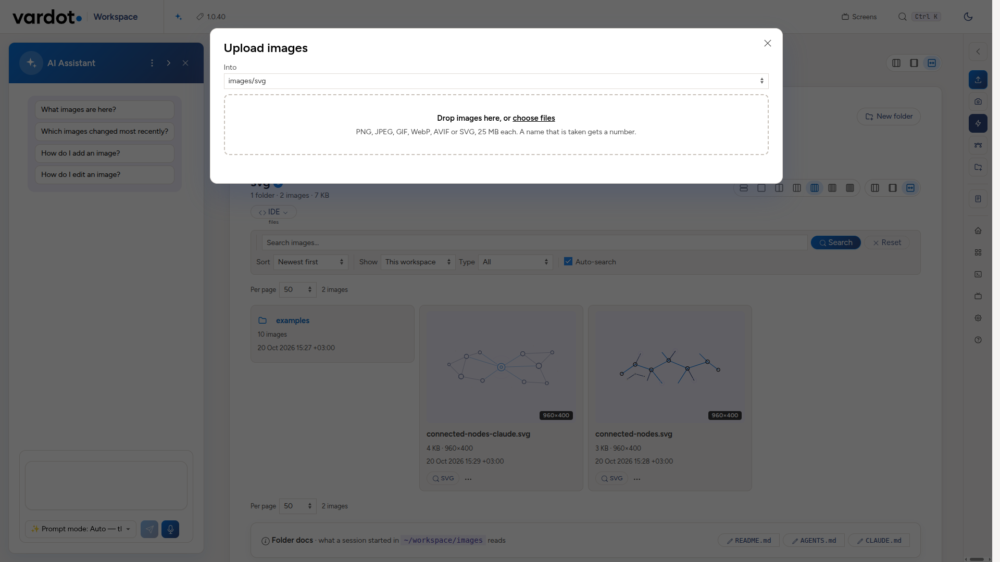

### Generate an image with AI

**Generate with AI** on the Images page: say what the picture should show, pick the shape, the quality and
how many, and press **See the plan**. The plan says what will be asked for and about what it costs; nothing
is sent until you press **Generate** and then **Yes**. The pictures land in `images/generated/`, and the
viewer shows the prompt and settings each one was made with.

Pick the **Provider** first: OpenAI, Google Gemini, xAI, Stability AI or Claude Code. The model, size and
quality fields change with it. A provider with no key on this machine is listed but greyed out, with the key
to set (`ai_providers.<provider>.api_key` in `core/config/settings.yml`).

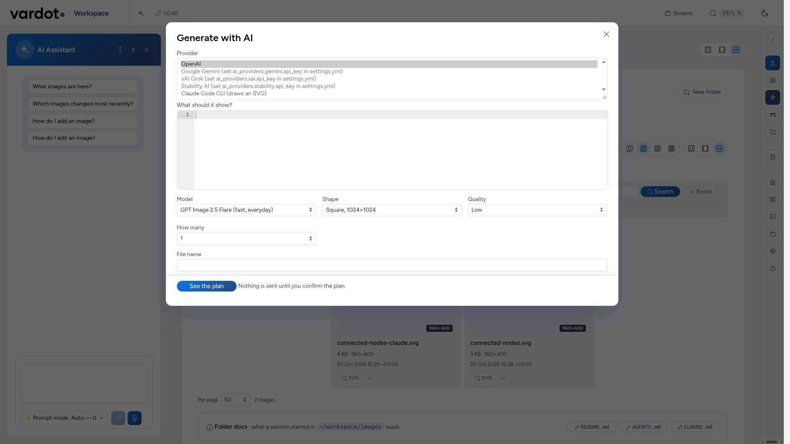

**Claude Code** needs no key: it uses your own Claude Code login, so there is no API charge. It cannot paint
a photo, so it draws a flat illustration as an SVG, and the dashboard turns it into a PNG as well; you keep
both, with the prompt, a summary and the alt text Claude wrote. It runs as a screen session, so it still asks
before it starts, and you can watch it on **Screens**. An SVG can be edited with AI only by Claude Code,
which changes its code into a new version.

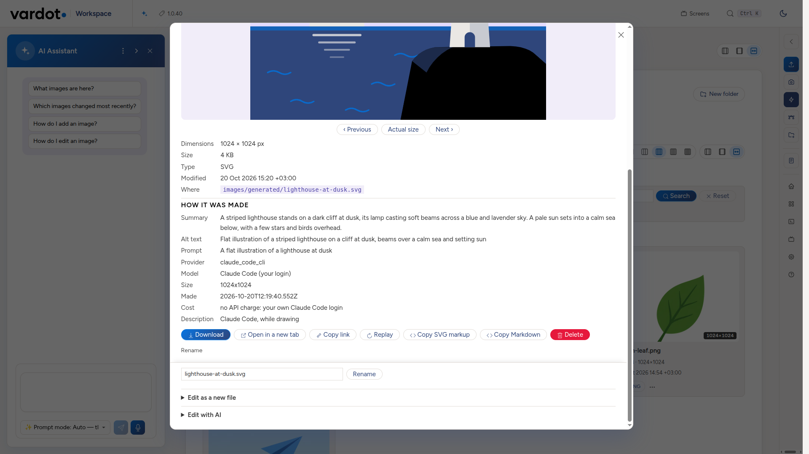

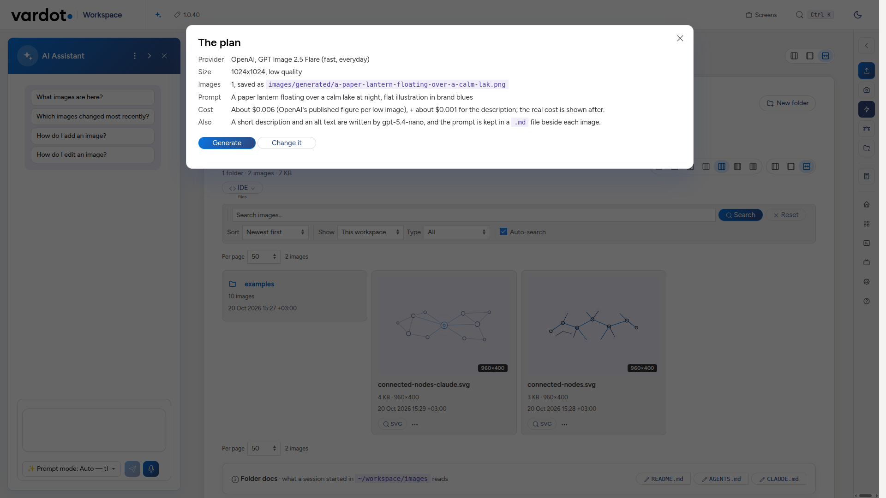

Each generated picture keeps its prompt. Beside `leaf.png` you get `leaf.md`, a readable record with the
prompt, the model, size, quality and date, and a short **description** and **alt text** written by a small
vision model right after the picture is made (about $0.001 more, shown in the plan). The viewer shows both
under *How it was made*, and **Copy Markdown** uses the alt text. If the description could not be written,
the viewer offers **Describe it**, which asks first because it is paid.

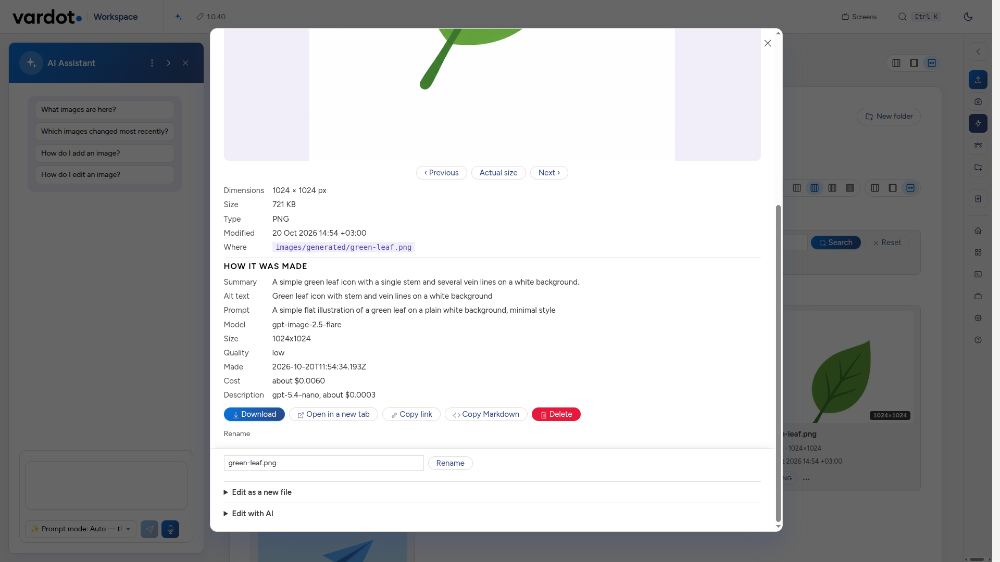

### Edit an image with AI

Open any image, from the Images workspace or from *All media images*, and use **Edit with AI** under it:
say what should change, pick the model, the size (*Same shape as the source* by default) and the quality,
and press **See the plan**. Nothing is sent until you press **Edit it** and then **Yes**. The result is a
new file, never the source: `<name>-ai-v1.png` beside an image in `images/`, or in `images/edited/` for an
image from another workspace. It gets the same `.md` record, description and alt text, and the viewer says
what it was edited from, with a link back. An SVG can be edited only with Claude Code, which changes its
code; an image model edits pictures.

### Generate an SVG

**Generate SVG** on the Images page asks a text model for a drawing as SVG code, still or animated, in the
brand colours. Pick the provider (OpenAI, Gemini, Anthropic or Claude Code), start from one of the
**examples** or write your own prompt, and choose a style:

- **Still**: no animation.
- **Draw the strokes**: outlines only; each part rises into place in turn while its strokes are traced.
- **CSS keyframes** or **SMIL**: the model writes its own animation.

Every animated style shows the finished drawing to anyone who has asked their system for less motion. The
palette comes from the brand tokens and can be changed for one drawing. As always you see the plan and press
**Yes** first. The drawing is cleaned of anything unsafe (scripts, event handlers, links that leave the
file), checked that it has enough in it, and asked for again with the reason when it does not, up to three
times. It lands in `images/svg/` with its prompt, summary and alt text. In the viewer, **Replay** plays the
animation again and **Copy SVG markup** copies the code. The defaults (the brief, the palette, the attempts,
the timing and the examples) are the `svg:` block in `core/config/workspace.images.settings.yml`.

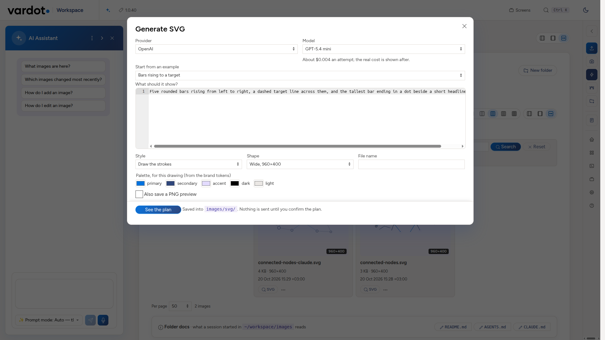

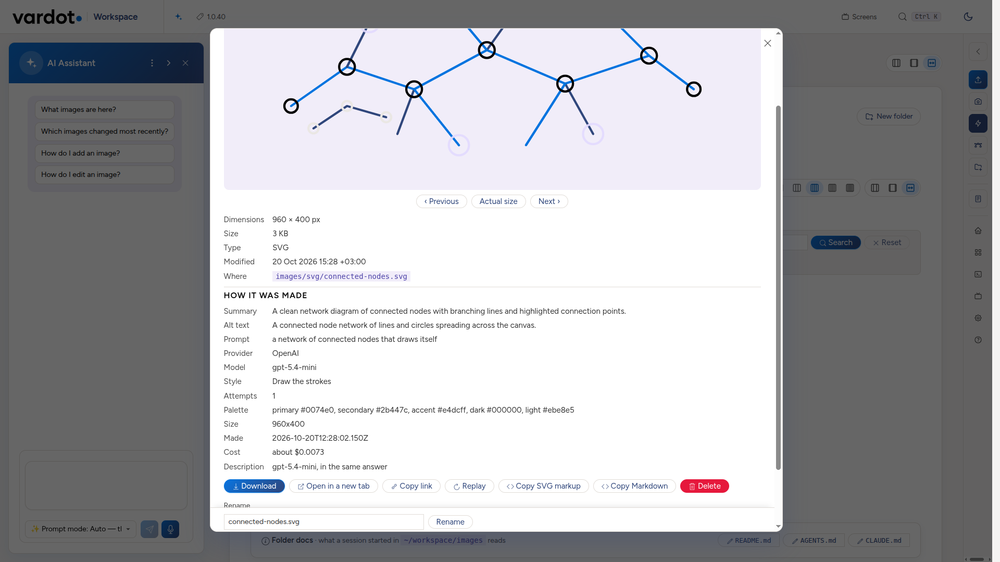

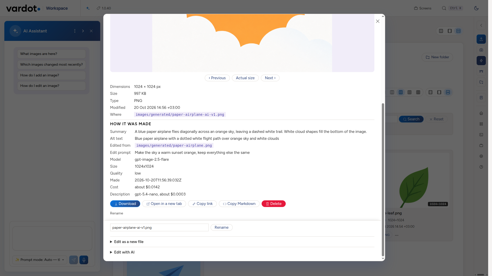

## Where things live

Each folder at `~/workspace` is a **workspace**, and each has a page in the dashboard.

| | for |
| --- | --- |
| **dev**, **test** | sites you are working on |
| **demos**, **sandboxes** | copies of the hosted client demos and sandboxes |
| **products**, **modules**, **themes**, **recipes**, **profiles** | code we maintain, as git clones |
| **docs**, **worklogs**, **specs** | documents, session worklogs, specifications |
| **ai-agents**, **ai-skills**, **ai-commands**, **ai-prompts** | the AI items, as drafts to edit |
| **designs** | Penpot, beside the Figma exports |
| **rag**, **graphs** | the search index and the code graphs |

---

## Keys

Press **Ctrl + K** (**Cmd + K** on a Mac), or **/**, anywhere to open one list of every workspace, page and project:
type a few letters, move with the arrow keys, press Enter. A project opens its site; a folder with no site opens
its workspace. **?** shows the shortcuts. **g** then a letter jumps to a workspace: `g d` is Dev, `g v` Videos,
`g s` Screens, `g h` Home. None of these fire while you are typing in a field or a terminal.

In any list, the search keeps what you type while it searches: you do not need to wait for it. On this
page, **Search the guide** keeps only the sections that hold every word and marks them.

## The AI assistant

Every page has one, on the right. It is the **AI Assistant** everywhere — one assistant, whose
conversation follows you between workspaces — and it is scoped to the page you are on: on `/dev` it
knows dev's projects, commands and rules.

It can actually do things: build, start, back up, open, and report. Ask in plain words.

**What it is called, and what its box says, are yours to set.** `assistant: name:` and
`assistant: placeholder:` in `core/config/settings.yml` are the defaults, for the home dashboard and
every page that belongs to no workspace; the same two keys in a workspace's own
`workspace.<name>.settings.yml` override them for that workspace's page alone. Both are on the
Settings screen, so neither needs a file edit. `default` in a workspace's file means "whatever
settings.yml says", which is what ships — so renaming it in one place still reaches every page.

The composer ships with **no placeholder at all**: an empty field with a cursor in it already says
*type here*, and a prompt that suggests what to ask narrows what gets asked. Set one if your team
wants the prompt.

**Type `@` or `/`** to call something by name:

- **`@`** — agents and skills, for example `@webship-js` or `@webship-multilingual-setup`
- **`/`** — commands and skills you invoke

The list shows what each one does, and whether it is installed or still only a draft in the
workspace. Some names are **both** an agent and a skill and they are not interchangeable — the agent
drives a whole job, the skill carries the steps — so the list shows which, and picking one writes
`@name (agent)`.

You do not need to name the workspace's own tooling (`webship-workspace…`); the assistant already
works by it.

---

## Keeping up to date

```bash
bash ~/workspace/core/workspace-app/scripts/update.sh --check   # what you have vs the latest
bash ~/workspace/core/workspace-app/scripts/update.sh           # update
```

The version you are running is in the **toolbar**, beside the product name. If it says
`version unknown`, the tree was installed in a way that did not record one — the tooltip lists the
commands that set it.

The updater touches **only** the dashboard app. Fresh tooling, config and settings come from
`bash ~/workspace/core/scripts/sync-tooling.sh --pull`, and the updater will refuse that job rather
than half-do it.

Some releases ship changes to the container image — the release notes say so, and then you also need
`cd ~/workspace/core/workspace-app && ddev restart`.

**If you are on 1.0.9 exactly**, run `bash ~/workspace/core/scripts/docker-gid.sh` once. That
release's updater did not put this machine's docker GID back, and the symptom is delayed: nothing is
wrong until your next `ddev restart`, when the dashboard shows **every project as Stopped** while they
all run perfectly well. Later releases re-apply it for you.

---

## When something is wrong

The single most useful command, and the first thing to run:

```bash
bash ~/workspace/core/scripts/install.sh --check
```

It changes nothing and reports every part of the setup: tools, https trust, Docker access, mounted
paths, the CLIs, the Web IDE, the exposure state, and the inotify limit.

| What you see | What it is |
| --- | --- |
| Every URL refused, `ERR_CERT_AUTHORITY_INVALID` | the local CA is missing or your browser has not read it. `trust-https.sh`, then **fully restart** the browser |
| `permission denied … docker.sock` | you have not logged out and back in since installing |
| Every project shows **Stopped** while they are clearly running | the dashboard container cannot see Docker or the DDEV registry. `bash core/scripts/docker-gid.sh --check` |
| Every `*.ddev.site` address dead, containers healthy | the shared `ddev-router` is gone. `cd ~/workspace/core/workspace-app && ddev start` brings it back |
| Nothing works after a reboot | DDEV projects do not come back by themselves. `bash core/scripts/autostart.sh --enable`, and `sudo loginctl enable-linger $USER` |
| **JIRA** is greyed out | `twg` is missing or not signed in. The tooltip says which; `~/.local/bin/twg login --force` |
| The Web IDE says *Unable to watch for file changes* | the kernel's inotify limit. `install.sh --check` prints the fix |
| A screen session looks stuck | check **Screens** — if it says `✋ waiting on a choice`, it is waiting for **you**. Open the terminal and answer it |

### One thing to know before you change it

On a laptop the workspace has **no login**, and that is safe because nothing is reachable from the
network: it listens on your own machine only. If you ever turn on `router_bind_all_interfaces`, or
point `hub_domain` at a real domain, then anyone who can reach that port gets a terminal, an editor
with write access to everything in `~/workspace`, and the Docker socket. The dashboard will show a red
banner the moment that happens. Do not ignore it.

Before that, turn on **Sign in with Google**: `auth.google.enabled: true` in `settings.yml`, with the
Google Workspace domains that may sign in in `auth.google.allowed_domains` (this repository ships
`example.com`) and single addresses in `auth.google.allowed_emails`. Both lists are edited on the
Settings page. With nothing allowed, nobody gets in.

---

## Settings

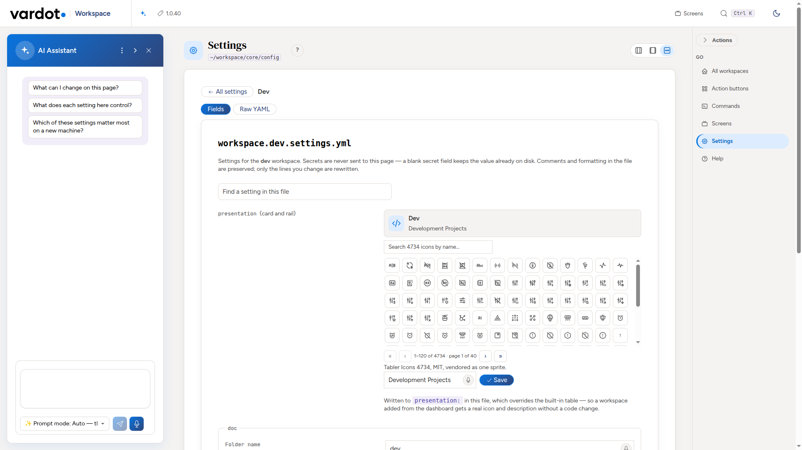

`core/config/settings.yml` and each workspace's own file, editable from the browser. A secret's value
never leaves the server: keys that look like passwords or tokens show as empty fields marked
*set — leave blank to keep it*, and the file is rewritten line by line so your comments survive.

**Settings** in the side rail opens them as a window over the page you are on, with the files as tabs
down the left; type in **Filter** to find a file. Inside a file:

- **Find a setting in this file** narrows the fields as you type.
- On/off values are switches that say **On** or **Off**.
- The comment written above a key in the file is shown under its name.
- **Unsaved changes** appears beside Save until you save, and leaving the page asks first.

A link such as `#settings/workspace.dev.settings.yml` opens that file from any page.

**Lists are rows, not text.** Every YAML list in a file is edited in place: type a new entry and press
**Add**, and each entry is checked as what it is (a machine name, a domain). Lists inside a block work
the same, such as `auth.google.allowed_domains` and `auth.google.allowed_emails`. A list whose order
matters, such as `workspaces:` (the order of the home page cards), has a handle to drag each row and
↑ ↓ buttons. Lists are saved as you change them, not with the Save button.

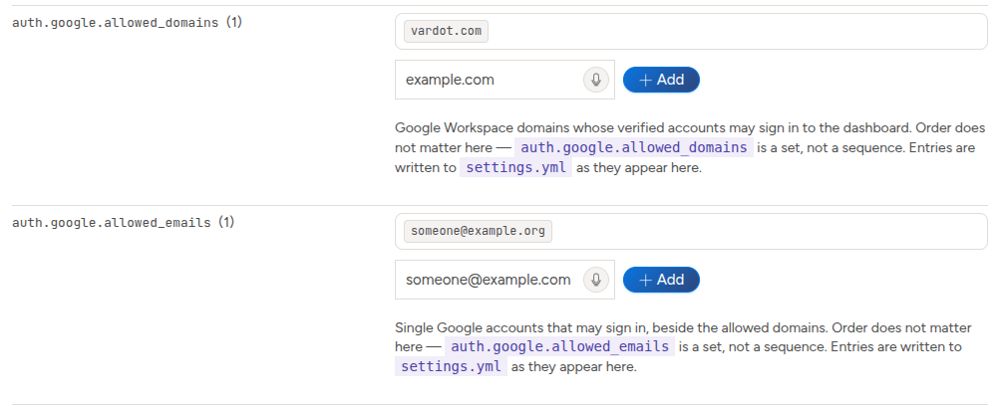

### Delete a workspace

A workspace that is **not used** can be deleted from the `workspaces:` list in `settings.yml`: its row
has a bin. Not used means nothing in its folder but its own tooling (`cmd-*.sh`, `README.md`,
`AGENTS.md`, `CLAUDE.md`, the `.code-workspace` file), no backups, no screen session running there,
and not the only workspace left. Any other workspace says **in use**, and pointing at it says why.

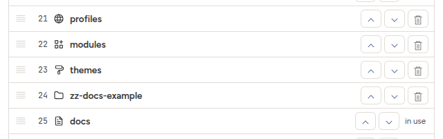

It asks three times, because it cannot be undone:

1. **Are you sure?**, in the same dialog as every other important action.
2. **Type the workspace's name.** The step lists what will go: the folder, its settings file, its line
   in `workspaces:` and its `*.<name>.workspace` hostname.
3. **Type `YES`**, then **Delete workspace**.

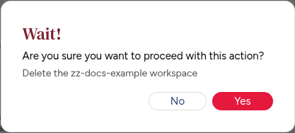

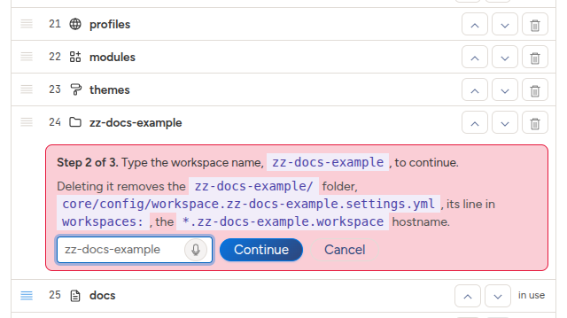

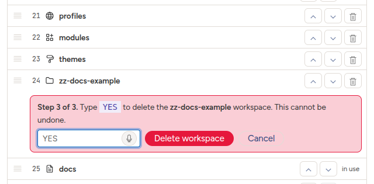

**Cancel** at any step leaves everything as it was. Adding a workspace (the field under the list) does
the same four things the other way round.

## Getting help

- `bash ~/workspace/core/scripts/install.sh --check` first — it answers most of it.
- Each workspace folder has a `README.md` (for you) and an `AGENTS.md` (the same folder explained to
  an AI agent). Both are worth reading for the folder you work in most.
- [`REFERENCE.md`](REFERENCE.md) is the full reference: every command, every flag, how to add your own.
- Ask the assistant. It can read the machine and tell you what it finds.
- [`core/workspace-app/docs/`](README.md) is this guide's longer sibling — the dashboard screen by
  screen — and [`DEVELOPER-GUIDE.md`](DEVELOPER-GUIDE.md) is for changing the tooling itself.
