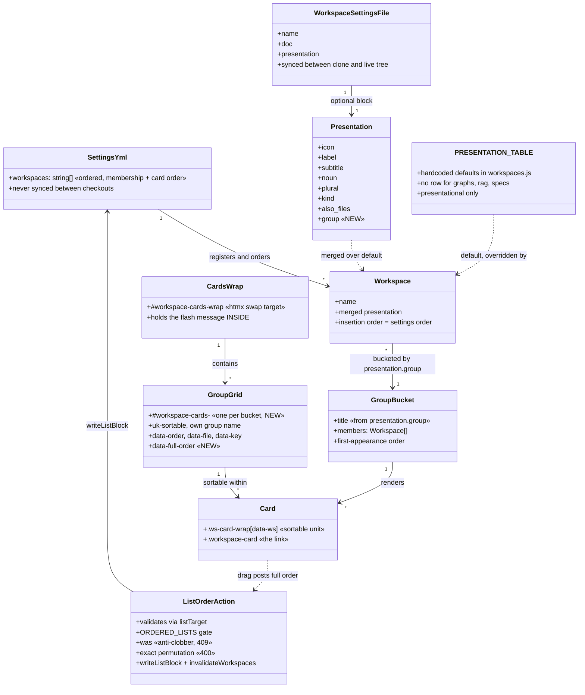

# REASONS Canvas — Group the dashboard workspace cards by purpose

## R — Requirements

**Why.** Home page renders every workspace as one card in one flat grid. Grid was fine at eight. Now twenty-plus. No landmarks: finding `rag` means reading names one by one instead of looking in a region. Cards are also genuinely different kinds — sites you build and run, code we ship, knowledge about the others, AI items a session loads — and the flat grid hides that. The rail deliberately carries no workspace list (a comment at ≈3145 records that nineteen links there read worse than the cards), so the home cards are the only workspace chooser. Their scannability is the whole problem.

**Scope boundary.**

In: `group:` in each workspace's `presentation:` block; grouped rendering on the home page with a heading per group; drag still reorders and still persists; a workspace with no `group:` still appears without a code change.

Out: per-workspace pages (`/dev`, `/rag`, …); renaming, merging, splitting or removing any workspace; collapsing groups, remembering collapsed state, filtering by group; changing what a card shows (icon, subtitle, counts, badges).

**Definition of done.**

| # | Done when |
|---|-----------|
| D1 | Home page shows workspaces under group headings, not one flat grid. |
| D2 | Every workspace in `settings.yml` appears exactly once, grouped or not. |
| D3 | A workspace whose settings file states no group still renders; page does not break. |
| D4 | Dragging a card still reorders it and still writes the new order to `settings.yml`. |
| D5 | Adding a group, or moving a workspace between groups, is a settings edit — no dashboard code. |
| D6 | Grouping legible at phone width as well as desktop. |
| D7 | A hand-written `group:` survives a Save in the presentation editor. |

D7 is not in the ask's list. It is added because `writeWorkspacePresentation()` rewrites the whole `presentation:` block from `icon` + `subtitle` alone: without it, D5 is false the first time anyone presses Save, and the card silently leaves its group. See A-3 and Open question 9 in the analysis — answered here as **in scope**, because the change cannot honour D5 without it.

**Acceptance criteria** (verbatim from the ask, plus the assumption they are read against):

| # | Given | When | Then |
| - | ----- | ---- | ---- |
| 1 | every workspace has a `group:` | open `https://workspace.ddev.site` | cards appear under one heading per group, in the order `settings.yml` lists them |
| 2 | a workspace with no `group:` | open home | it still renders as a card, no other card lost |
| 3 | two cards in the same group | drag one over the other | order changes, survives reload |
| 4 | a settings file edited to change one `group:` | reload home | card moved to the other group, no restart, no code change |

**Assumptions** — every open question in the analysis, answered here as an assumption, not invented silently:

- **A-1 (Q1) Groups and their names.** Four, keyed lowercase, rendered from the settings value: `sites`, `code`, `knowledge`, `ai`. Assignment used by this change, for the clone's 20 names: `sites` — projects, dev, test, demos, sandboxes; `code` — products, profiles, modules, themes, libraries, recipes, site-templates; `knowledge` — docs, videos, graphs, designs, worklogs; `ai` — agents, skills, prompts. Live-tree extras: `rag` → knowledge, `specs` → knowledge. This assignment is a judgement call from the ask's four sketched kinds; it is a settings edit, so a reviewer changes it without touching code.
- **A-2 (Q2) Group order = first appearance in `workspaces:`.** No `groups:` block. A second ordered list would be a second thing every drag must keep in sync, with its own concurrency guard. One source of order.
- **A-3 (Q3) Heading text is derived from the value, title-cased, with no label map.** `group: knowledge` → "Knowledge". Optional per-group display text is out; a map is a second place to edit and a group can then exist with no label. Values chosen in A-1 title-case cleanly; `ai` title-cases to "Ai", so **the values carry display text directly**: `group: Sites`, `group: Code`, `group: Knowledge`, `group: AI` — matching the codebase's existing acceptance of display text in `label` and `subtitle`. Bucketing keys on the exact string.
- **A-4 (Q4) Members need NOT be contiguous in `workspaces:`.** Render walks the settings list once and buckets in encounter order; each group's internal order is settings order. AC 1's "in the order `settings.yml` lists them" is satisfied *within* each group, which is the only order a grouped page can show.
- **A-5 (Q5) One sortable per group; the client posts the full reconciled list.** Server-side `/actions/list-order` keeps its permutation guard and its `was` guard unchanged. See Approach.
- **A-6 (Q6) No cross-group drag.** Each group's sortable gets its own UIKit group name, so UIKit refuses the drop rather than accepting it and reverting on swap-back.
- **A-7 (Q7) Defaults live in the per-workspace `workspace.<name>.settings.yml` files.** Those sync between clone and live tree; `settings.yml` never does, and `PRESENTATION` is code. `graphs`/`rag`/`specs` already carry their whole presentation this way — the working precedent.
- **A-8 (Q8) Ungrouped workspaces render last, under a heading "Other".** A heading, not a bare tail: an unheaded tail after headed regions reads as a rendering bug. Heading emitted only when the bucket is non-empty.
- **A-9 (Q10) `addWorkspace()`'s "keep docs and worklogs last" rule stands, untouched.** A new workspace lands where it lands and is ungrouped, so it appears under "Other" until someone gives it a `group:`. That is D5 working, not a defect.
- **A-10 (Q11) The Settings list editor stays flat.** `LIST_META.workspaces.note` is amended so the two views do not describe the same data differently; grouping that editor is unscoped work.
- **A-11 (Q12) The clone is authoritative.** Target is `products/workspace` — 20 workspaces, with `libraries`, without `rag`/`specs`. The live tree's 21 are covered too (A-1 assigns `rag` and `specs`), but the definition of done is read against the clone's list. The ask's "twenty" is the clone; its 21 names are the live tree.
- **A-12 (Q13) An empty group renders nothing** — no heading. Buckets are built from workspaces, so an empty bucket cannot exist unless a group name is written nowhere; that is the same thing as absent.
- **A-13 (Q14) Verification is a person loading the page at two viewport widths, plus a Node syntax check.** The provided context shows no test exercising the dashboard's HTML; `cmd-smoke-test.sh` is described as a smoke test over argparse shell scripts. Each operation below names the check it actually gets. No operation claims an automated guard that does not exist.

---

## E — Entities

Vocabulary this change must keep straight, from the analysis:

- **workspace** — not "category", not "section".
- **card order** — the order of `workspaces:`. The phrase the code itself uses.
- **kind** — `projects` vs `files`. Independent of `group:` and deliberately not aligned with it: `rag` is `kind: projects` with `also_files: true` and `group: Knowledge`.
- **group** — new, and colliding with `commandMenuGroups()` / `listAllCommands()`, which already produce "groups" keyed by workspace. New identifiers in `server.js` use `wsGroup*` / `groupedWorkspaces`, never a bare `groups`.

---

## A — Approach

**A-1. Bucket by walking the settings list once; never walk a group list and look workspaces up.**

`Object.values(workspaces)` is already in settings order. One pass appends each workspace to a `Map` keyed on its group string, creating the bucket on first sight. A `Map` preserves insertion order, so bucket order is first-appearance order (A-2 assumption). Workspaces with no `group:` go to a single "Other" bucket, appended last.

This shape makes D2 structurally true: every workspace is visited exactly once and pushed exactly once. A typo'd group value produces a heading nobody expected — visible and harmless — not a vanished card. The rejected alternative, iterating a known list of groups and looking members up, is precisely how the analysis says the invariant breaks: a typo drops a card, a mis-keyed lookup doubles one.

**A-2. One sortable per group, and the client posts the reconciled full list.**

The drag contract is a flat-list contract in three places at once: `closest('#workspace-cards')`, one `data-order` for `was`, and a server-side exact-permutation check. Splitting the DOM breaks all three in the same motion.

Chosen: split the DOM, keep the server contract untouched. Each group grid carries `data-full-order` — the complete comma-joined settings order — and `data-order` for its own members. On `moved`, the client reads the changed grid's new member sequence, then rebuilds the full list by walking `data-full-order` and substituting, in encounter order, the group's new sequence at the positions its members occupied. Result is a list of the same names, the same count, in the same positions for every workspace outside the dragged group. It is an exact permutation, so `/actions/list-order` accepts it with no change to the permutation guard, no change to the `was` guard, no change to `ORDERED_LISTS`.

Substitution-at-occupied-positions is what makes A-4 (non-contiguity) safe. If a group's members are scattered through `workspaces:` — and today they are: `docs, videos, graphs, specs, rag, designs` sits between `demos` and `projects` — the rewrite still touches only those scattered slots. Nothing else moves. No contiguity is required of `settings.yml`, and none is imposed on it.

Rejected — **relax the server's permutation check to accept a partial order**: that guard exists because "an entry lost from this list unregisters a workspace", and it was added after a real scrambling incident along with the `was` 409. Relaxing it needs a replacement guarantee this change cannot offer. Rejected — **one sortable over all cards with headings interleaved**: UIKit sorts the grid's own children, so headings would be draggable items, and a card could be dropped between two groups with no defined meaning. Rejected — **render grouped but keep one hidden flat sortable**: two DOM copies of every card, and D2 becomes a claim rather than a structure.

**A-3. `group:` is read live, never baked.**

`_loadWorkspacesFresh()` already merges `{...PRESENTATION[name], ...wsSettings.presentation}` on every read, memoised for 2 s. `group` needs no special handling there beyond being carried through the merge and not stripped — the merge is a spread, so it arrives free. What must NOT happen is deriving a group map into a module-level constant: AC 4 states "no restart", and a constant computed at load gives a card that moves group only after a container restart.

**A-4. Defaults ship in the per-workspace settings files, not in `PRESENTATION`.**

`PRESENTATION` is code, does not sync, and has no row for `graphs`, `rag` or `specs` — so a default expressed there reaches three workspaces not at all, and makes every future workspace land ungrouped until someone edits the dashboard. That contradicts the norm "a new workspace is a settings file plus a folder, never a dashboard code change". The per-workspace files sync, and the three presentation-only workspaces are the precedent that a purely presentational key can live there and nowhere else. `PRESENTATION` is not touched by this change.

**A-5. Fix `writeWorkspacePresentation()` to preserve unknown keys.**

It rewrites the whole `presentation:` block from `icon` and `subtitle`, silently deleting `label`, `noun`, `plural`, `kind`, `also_files` — and now `group`. Grouping is what makes the loss visible: the card jumps to "Other" on the home page. Fix is scoped exactly: read the existing block, replace only the two keys the form owns, re-emit the rest untouched. No group field is added to the editor — the scope excludes changing what a card shows, and D5 says group is a settings edit. Preservation, not a new control.

**A-6. Headings are `h3`, cards keep `h4`.**

Cards are currently `h4` inside a flat grid. A group heading above them must be a level up, or the outline inverts. Each group region is a `<section>` labelled by its heading via `aria-labelledby`, so the grouping is a real structure for a screen reader and not a visual-only one.

**A-7. Phone legibility is designed, not asserted.**

Base is `uk-child-width-1-2`, so 21 cards are ~11 rows and four headings add height to a page with no other navigation. Headings therefore get small vertical rhythm at the small breakpoint, not large — landmark on desktop, marker on phone. The handle's `opacity: .7` small-breakpoint rule means handles are always visible on phones, so heading text sits at the region's left edge with clearance from where a handle sits.

---

## S — Structure

Target checkout: `/home/rajab/workspace/products/workspace` (the clone; A-11).

| File | What changes | Fits what exists |
|---|---|---|
| `core/config/workspace.<name>.settings.yml` × 20 | `presentation:` gains one `group:` line. Files with no `presentation:` block gain one holding only `group:`. | The only per-workspace file that syncs; already the home of `icon`, `label`, `subtitle`, `noun`, `kind`, `also_files`. |
| `core/workspace-app/workspaces.js` | Comment only, at the merge in `_loadWorkspacesFresh()`, recording that `group` is presentational, read live, and absent from `PRESENTATION` on purpose. No logic change — the spread already carries it. | Norm: comments say why, and say what a thing does not cover. |
| `core/workspace-app/server.js` `homeCardsHtml()` ≈1976–2008 | Bucket, then emit one `<section>` + `<h3>` + `#workspace-cards-<slug>` grid per bucket, inside the unchanged `#workspace-cards-wrap` with the message still inside it. | The only function that renders the grid, and the one `/actions/list-order` returns. |
| `core/workspace-app/server.js` `homePage()` ≈2010 | Untouched unless the single `uk-card` body proves wrong for a grouped page — decided at Op 5's visual check, not assumed now. | Thin wrapper. |
| `core/workspace-app/server.js` `writeWorkspacePresentation()` ≈1537 | Preserve every `presentation:` key the form does not own. | Fixes a pre-existing silent deletion that grouping would make user-visible. |
| `core/workspace-app/server.js` `LIST_META.workspaces.note` ≈1264 | Note amended: the list is still the card order, and the cards are now shown grouped. | Two views of one list should not describe it differently (A-10). |
| `core/workspace-app/public/ui.js` ≈114–137 | `closest('[data-ws-group-grid]')`; read `data-full-order`; reconcile; post the full list. `file`, `key`, `view:'home'` and the `#workspace-cards-wrap` `outerHTML` swap unchanged. | Keeps the server contract intact (A-2). |
| `core/workspace-app/public/style.css` | Heading + section rules; `#workspace-cards`-scoped sortable/placeholder rules ≈2615–2632 re-scoped to the new per-group grids; phone rules near ≈694/≈1726/≈1752. | No build step — plain CSS. |

Not touched, per scope: `workspacePage()` and every `/<workspace>` route; the rail; `PRESENTATION`; `addWorkspace()`; `/actions/list-order`; `readListBlock`/`writeListBlock`; `core/config/settings.yml`.

Commands and settings: no new `cmd-*.sh`, no new argparse, no new settings key in `settings.yml`. The only new setting is `presentation.group` in the per-workspace files — which is why "add a group" is an edit, not a deploy.

---

## O — Operations

Each operation names its file, its done-item, and how it is verified. Verification is honest about what exists: there is no test that renders the dashboard's HTML (A-13), so the checks are a Node parse, a live page load at two widths, and a real drag.

**Op 1 — Give every workspace a group.** → D5, D2, AC 1
Files: `core/config/workspace.<name>.settings.yml`, all 20 in the clone. Add one `group:` line inside `presentation:`, per A-1/A-3 assignment, values `Sites` / `Code` / `Knowledge` / `AI`. Where a file has no `presentation:` block, add the block with only that key. Leave every existing key untouched.
Verify: `grep -c '^  group:' core/config/workspace.*.settings.yml` accounts for all 20 files; each file still parses (`node -e` YAML load, or the dashboard's own `parse_yaml` path via a page load in Op 5). No `settings.yml` edit — confirm `git status` shows only `workspace.*.settings.yml`.

**Op 2 — Record why `group` is not in `PRESENTATION`.** → D5
File: `core/workspace-app/workspaces.js`, at the merge in `_loadWorkspacesFresh()`. A comment stating that `group` is presentational, arrives through the existing spread, is deliberately absent from the `PRESENTATION` default table because that table is code and does not sync between the two checkouts, and that a workspace with no `group` is expected and renders under "Other".
Verify: `node --check core/workspace-app/workspaces.js`. Read the diff — it must contain no executable line.

**Op 3 — Bucket and render groups in `homeCardsHtml()`.** → D1, D2, D3, AC 1, AC 2
File: `core/workspace-app/server.js` ≈1976–2008. Walk `Object.values(workspaces)` once, appending each to a `Map` keyed on `ws.group` (falsy → the "Other" bucket, forced last). Emit, inside the unchanged `#workspace-cards-wrap` and with the result message still inside it, one `<section aria-labelledby>` per non-empty bucket, each containing an `<h3>` and a grid `
" data-ws-group-grid>` carrying the existing `uk-grid uk-grid-small uk-child-width-1-2 uk-child-width-1-3@s uk-child-width-1-4@m` classes, `uk-sortable` with a per-group `group:` name (A-6: no cross-group drop), `data-order` for its own members, `data-full-order` for the whole list, and the existing `data-file` / `data-key`. Cards themselves unchanged. Identifiers named `wsGroup*` / `groupedWorkspaces`, never bare `groups` (collision with `commandMenuGroups()`).
Verify: `node --check core/workspace-app/server.js`; then Op 5's page load. Card count on the rendered page must equal the length of `workspaces:` — that is AC 2, checked by counting `.ws-card-wrap` in the browser, not by reading the code.

**Op 4 — Prove D3 with a real ungrouped workspace.** → D3, AC 2
File: one `core/config/workspace.<name>.settings.yml` — temporarily remove its `group:` line.
Verify: reload; that card appears under "Other", every other card still present, no error in the container log. Then restore the line and reload — the card returns to its group with no restart, which is AC 4 verified on the same motion.

**Op 5 — Load the page at desktop and phone width.** → D1, D6, AC 1
No file. Open `https://workspace.ddev.site` at a desktop width and at a phone width. Confirm: one heading per group; within each group, cards in `settings.yml` order; headings read as landmarks at 2-up without crowding the always-visible handles; the `h3`/`h4` outline is not inverted. If the single enclosing `uk-card` body in `homePage()` (≈2010) makes the grouped page read as one undifferentiated slab, change it here and re-check; otherwise leave it.
Verify: this is the check. Record the two widths used.

**Op 6 — Style the headings and re-scope the sortable rules.** → D1, D6
File: `core/workspace-app/public/style.css`. Add section/heading rules. Re-scope the `#workspace-cards .uk-sortable-placeholder` rules at ≈2615–2632 to the new per-group grids — they are scoped to one id that no longer exists, so without this the drag placeholder is unstyled. Add the phone-breakpoint heading rhythm near the existing phone rules (≈694, ≈1726, ≈1752). Plain CSS, no build step.
Verify: reload at both widths; drag a card and watch the placeholder render as it did before.

**Op 7 — Reconcile the full order on the client.** → D4, AC 3
File: `core/workspace-app/public/ui.js` ≈114–137. Replace `closest('#workspace-cards')` with `closest('[data-ws-group-grid]')`. Read the dragged grid's new `.ws-card-wrap` sequence and its `data-full-order`; rebuild the full list by substituting that sequence into the positions its members occupy in `data-full-order`, in encounter order. Post `order` = the full reconciled list, `was` = `data-full-order`, and the unchanged `file`, `key`, `view:'home'`; keep the `#workspace-cards-wrap` `outerHTML` swap.
Verify: `node --check core/workspace-app/public/ui.js`; then Op 8.

**Op 8 — Drag, reload, and read the file.** → D4, AC 3
No file edited. In the browser: drag a card over another in the same group. Confirm the "✅ Card order saved" message flashes (it must, since it is still inside the swapped `#workspace-cards-wrap`); reload and confirm the new order persists. Then read `core/config/settings.yml`'s `workspaces:` — it must hold the same names and the same count as before, with only the dragged group's slots reordered, and the file's comments and formatting intact (`writeListBlock` rewrites only the `- item` lines). A 400 ("does not match") or a 409 here means the reconciliation in Op 7 is wrong, not the server.
Verify: the reload, and the diff of `settings.yml`.

**Op 9 — Confirm cross-group drop is refused.** → AC 4's premise (group changes are settings edits only)
No file edited. Drag a card from one group's region over another's. It must not be accepted — no drop, no revert-on-swap-back. Per A-6 this follows from each grid having its own UIKit sortable group name; if UIKit accepts it, fix the group naming in Op 3 and re-check here.
Verify: the attempted drag.

**Op 10 — Preserve unknown keys in `writeWorkspacePresentation()`.** → D7, D5
File: `core/workspace-app/server.js` ≈1537. Read the existing `presentation:` block, replace only `icon` and `subtitle`, re-emit every other key unchanged. Comment states why: this block carries keys the form does not own (`label`, `noun`, `plural`, `kind`, `also_files`, `group`), and rewriting it wholesale silently deleted them. No new form field.
Verify: `node --check`; then open the presentation editor for `rag` (six presentation keys — the richest case), press Save with no change, and read `core/config/workspace.rag.settings.yml`: `group`, `label`, `noun`, `kind` and `also_files` all still present. Reload home — the card is still in its group and still says "RAG".

**Op 11 — Amend the settings-list note.** → D1
File: `core/workspace-app/server.js` `LIST_META.workspaces.note` ≈1264. The note currently says "The workspaces this dashboard shows, in card order." Amend so it also says the cards are shown grouped by `presentation.group`, and that this editor stays flat.
Verify: open `/settings`, read the note beside `workspaces:`, confirm the list editor still reorders via its up/down buttons (kept for keyboard use) and that a move there still lands on the home page.

**Op 12 — Run the workspace's own validation, and say what it did not cover.** → all
Command: `bash core/scripts/tests/cmd-smoke-test.sh` from the clone. Exit code is the failure count.
Verify: exit 0. State plainly in the change's description that this smoke test covers the shell tooling and does **not** exercise `homeCardsHtml`, `ui.js` or the CSS — the evidence for those is Ops 4, 5, 8, 9 and 10, done by a person. No claim of automated coverage that does not exist.

**Op 13 — Propose the change for review.** → all
No merge, no push to a branch. Fork branch, then a PR against `github.com/webship/workspace` `1.0.x`, only after asking. Body names the target checkout (the clone, 20 workspaces), the assumptions A-1 through A-13 that a reviewer may overrule by editing settings, and the two viewport widths from Op 5. Ends with the default Checkpoints checklist verbatim; ticks only "File an issue" and the Addition/Change entry. `Reviewed by a human` and `Code review by maintainers` stay unticked.
Verify: the human reviews and merges. Then, and only then, sync to the live tree with `cd ~/workspace/products/ && bash cmd-tools-sync-tooling.sh --pull` — and add `group:` to the live tree's `workspace.rag.settings.yml` and `workspace.specs.settings.yml`, which have no counterpart in the clone.

---

## N — Norms

- **Dashboard work is Node + HTMX in `core/workspace-app`, no framework, no build step.** Every operation here is plain JS in `server.js` / `ui.js` / `workspaces.js` and plain CSS in `style.css`. No bundler, no template engine, no client framework introduced for the grouping.
- **A new workspace is a settings file plus a folder — never a dashboard code change.** This is the norm that decides A-4: shipped group defaults go in the per-workspace settings files, not in `PRESENTATION`. It is also why a workspace with no `group:` must render (D3) — a new folder must not need a code edit to appear.
- **Settings come from `settings.yml` and `workspace.<name>.settings.yml`, read with the settings reader; an argument actually given beats a setting.** Here the equivalent: an explicit `presentation.group` beats the absence-default ("Other"), and the value is read live on each request rather than baked at load (A-3), which is what makes AC 4's "no restart" true.
- **Comments explain WHY and state what a thing does not cover.** Op 2's comment says why `group` is absent from `PRESENTATION` (that table is code and does not sync). Op 3's says why the render walks the settings list and buckets, rather than walking a list of groups — a card must not be able to vanish from a typo. Op 10's says which keys the presentation form does not own. Op 6's says why the placeholder rules moved off `#workspace-cards`.
- **Documentation that would go stale is not written.** No new doc page for grouping. The `LIST_META` note (Op 11) is the one place a person meets the concept in the UI, and it lives next to the thing it describes.
- **Commands are `cmd-*.sh` + `args/arg-*.sh` + `functions/fun-*.sh`, self-locating via `bootstrap.sh`.** This change adds no command, so the norm binds only negatively: no shell script is added, and nothing is written to a shell profile or an environment variable to make grouping work.
- **Terse in anything published.** The PR body (Op 13) states the target checkout, the assumptions, and the manual evidence — not the reasoning that produced them. That stays here.

---

## S — Safeguards

**From the standing list, as they bind here:**

- **Never `git commit` locally, never push to a branch.** Op 13 only: fork branch → PR against `webship/workspace` `1.0.x` → the human reviews and merges. This change is proposed, never merged.
- **Never create an issue or PR without asking first.** Op 13 proposes title, target and contents, then waits for an explicit yes. Nothing is created before that.
- **Never close, reopen or delete an issue, PR or branch.** Including if this work is interrupted — a stop signal is not an instruction to undo published work.
- **No release, tag or publish.** This change ships no version and touches no tag.
- **`core/config/settings.yml` holds real credentials.** It is never synced, never committed, never echoed into a job log or a command line. Op 8 reads its `workspaces:` block by eye in the editor; it is not `cat`-ed into a transcript, not pasted into the PR, and not printed by any verification step. The grouping design deliberately keeps this file out of the change's edits (only drags write it, through `writeListBlock`, as they already did).
- **Destructive actions confirm first and say what will be lost.** Op 4 removes a `group:` line temporarily and restores it in the same operation; that is the only removal, it is one line in a synced settings file, and it is stated before it is done.
- **Containers only (DDEV by default).** Everything runs in the existing `ddev-workspace-web` container. No raw composer/drush/mysql on the host, no `$databases` block written anywhere.
- **CI stays `allow_failure: false`; never mask a failing check.** Op 12 reports `cmd-smoke-test.sh`'s exit code as it is, and states explicitly what that smoke test does not cover rather than letting a green exit imply the dashboard was tested.

**Specific to this change:**

- **Nothing is deleted from `workspaces:` — ever.** The server's exact-permutation guard and its `was` 409 exist because a lost entry unregisters a workspace, and were added after a real scrambling incident. Both stay exactly as they are. The reconciliation in Op 7 is written to satisfy them, not to route around them. If a drag ever produces a 400 or 409, the client is wrong and gets fixed; the guard does not get relaxed.
- **`PRESENTATION` is not edited.** Its 20 rows and its three deliberate absences (`graphs`, `rag`, `specs`) stay as they are. Adding group rows there would break the "a new workspace is a settings file" norm and would not sync.
- **`addWorkspace()` and `/actions/list-order` are not edited.** Their existing rules — including "keep docs and worklogs last" — are left intact (A-9). If grouping later makes that placement rule read oddly, that is a separate, separately-reviewed change.
- **The `#workspace-cards-wrap` wrapper and the message-inside-it placement are not changed.** A recorded bug says a message placed as a sibling was never flashed. Op 3 keeps the wrapper and keeps the message inside; Op 8 verifies the flash still happens.
- **Everything here is reversible by editing settings.** Group assignment, group order, heading text and group membership are all settings values in synced per-workspace files — no code path hardcodes a group name or a group list. Reverting the whole change is a revert of one PR; reverting one workspace's placement is deleting one line.
- **Live tree is touched only after the PR merges**, via `cmd-tools-sync-tooling.sh --pull` (Op 13). The clone is the target; the live tree is not edited ahead of review, and its two clone-less workspaces (`rag`, `specs`) get their `group:` there, after.
